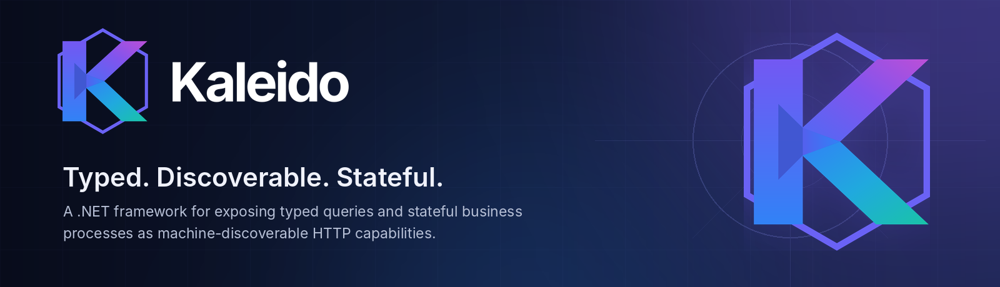

<p align="center">
  
</p>

<p align="center">
  <strong>Build business services that describe their capabilities, execute their actions, and tell applications and AI how to continue.</strong>
</p>

<p align="center">
  
  
  <a href="LICENSE"></a>
  
  <a href="src/Kaleido.Http.Mcp/README.md"></a>
</p>

<p align="center">
  <a href="https://github.com/no1ross/Kaleido/actions/workflows/build.yml"></a>
  <a href="https://github.com/no1ross/Kaleido/actions/workflows/codeql.yml"></a>
  <a href="https://sonarcloud.io/summary/new_code?id=no1ross_Kaleido"></a>
  <a href="https://sonarcloud.io/component_measures?id=no1ross_Kaleido&amp;metric=coverage"></a>
</p>

> [!IMPORTANT]
> Kaleido is under active pre-1.0 development. APIs and package boundaries may change while the public contract is refined. Use the preview for evaluation and experimentation, not as a stable compatibility or production-readiness commitment.

## What is Kaleido?

**Kaleido is a code-first .NET framework for building business services as discoverable queries and executable, stateful steps.**

You implement the business behavior. Kaleido describes the capabilities, validates their declared inputs and process rules, runs the business handlers, records process progress, and returns what can happen next.

Applications use those capabilities through HTTP. A compatible AI agent connects through the **Model Context Protocol (MCP)** adapter and receives the tools, schemas, instructions, lookup details, and continuation guidance needed to interact with them. It does not need a separately programmed, product-specific workflow before connecting.

| Building block | Purpose | Example |
|---|---|---|
| **Queryable** | Publish business information through typed, searchable sources and views. | Find a member or provider. |
| **Process** | Execute business actions with validation, dependencies, availability rules, and resumable state. | Capture a member, select a provider, or submit a request. |
| **Registry** | Describe the available capabilities, their inputs, constraints, relationships, and routes. | Supply discovery metadata for applications and MCP tools for AI. |

**It describes the work. It also runs the work.** Kaleido is not just an API catalog, and it is not an AI model. Its core runtime remains independent of the optional HTTP and MCP adapters.

### What it is for, and what it is not

**Kaleido is for** a contract-first process and query layer over the systems of record you already run: one definition of each business action and query, used the same way by screens, integrations and AI agents. It modernizes the experience over systems that cannot be replaced yet.

| Kaleido is not | Instead |
|---|---|
| A general workflow or orchestration engine | No timers, scheduled waits, sagas or compensation. A process moves when a consumer runs its next step; long-running orchestration stays with a dedicated engine. |
| A system of record | Kaleido keeps the process state (progress, pending questions, who ran what). Business data stays in your systems, behind your handlers and sources. |
| A decision maker | Your handlers decide; Kaleido applies the rules you declare ([ADR 0001](docs/decisions/0001-process-engine-not-decision-maker.md)). |

**Compatibility promise.** During the 1.0 preview any release may break the public API, the wire contracts, error codes or configuration; each break is named in its pull request and the [changelog](CHANGELOG.md), and the public API is recorded so no change goes unnoticed. From 1.0 the packages follow Semantic Versioning: a breaking change to the public API, the HTTP wire contracts, the error codes or the telemetry names needs a new major version. Details: [Versioning, compatibility and support](docs/VERSIONING.md).

## Why Kaleido?

A business process should not have to be implemented again inside every screen, integration, or conversational agent. When both a service and an agent maintain the workflow, a business change requires coordinated implementation, testing, and releases across teams.

Kaleido keeps the business action and process definition in the service. Consumers receive the information needed to use it rather than maintaining another product-specific workflow.

- **Describe once, expose consistently.** Ordinary .NET types and metadata describe queries, actions, inputs, validation constraints, and lookup relationships.
- **Keep progress in the process.** A process identifier and recorded state support continuation without relying on a screen sequence or reconstructing progress from chat history.
- **Make AI a first-class consumer.** The MCP adapter derives its interface from the same capabilities used by other applications, rather than a parallel implementation of the business.
- **Keep business ownership explicit.** Handlers own domain behavior and decisions. Kaleido supplies execution mechanisms and applies the rules you declare.
- **Adopt the parts you need.** HTTP, remote clients, MCP, persistence, and OpenTelemetry remain separate integrations around the core runtime.

### Why the project was started

Kaleido began as a working demonstration of a step concept that years of verbal explanation had not made clear: what an action requires, what it does, and how the process continues. That same explicit model now makes the business usable through AI.

## How it works

### Define the action in the service

A step is a **business action, not a screen or a chat turn**. Its declaration describes the action and its inputs; a separate handler implements what the action does.

This excerpt from the [PriorAuth sample](https://github.com/no1ross/Kaleido-Samples-PriorAuth) shows where the interaction information starts. Namespace imports and the enrollment and date inputs are omitted; this is not the complete class or a runnable service.

```csharp
[ProcessStep(
    DisplayName = "Intake - Capture Member",
    Description = "Records member information against the intake session for auditing and correlation.",
    Version = "1.0.0")]
[AvailableAfter<ValidateMemberStep>]
public sealed record CaptureMemberStep : IProcessStep
{
    [Required]
    [Description("The validated member: the same Member Search result the caller picked for Validate Member.")]
    [Display(
        Name = "Member",
        Prompt = "What is the member's ID, first and last name, and date of birth?")]
    [Lookup(
        Service = "member",
        Source = nameof(MemberQueryContextSource),
        View = nameof(MemberSearchViewSource),
        Field = "MemberId",
        Display = ["DisplayName", "DateOfBirth", "MemberNumber",
                   "PlanName", "EffectiveDate", "TerminationDate"])]
    public required Guid MemberId { get; init; }

    // MemberEnrollmentId and DateOfService are omitted from this excerpt.
}
```

| Declaration | Meaning |
|---|---|
| `ProcessStep` | Names the action and describes its purpose and version. |
| `AvailableAfter<ValidateMemberStep>` | Makes completion of validation an availability condition; it does not automatically execute this step or make it the required next step. |
| `Required` and the property type | Declare required input and its shape. |
| `Display` / `Description` | Supply the input's label, prompt, and explanation. |
| `Lookup` | Identifies the query and result field supplying the value, plus the fields used to help a person recognize the record. |

**This is service code, not agent code.** Kaleido publishes the registered metadata as tool descriptions and schemas; the agent does not read this C# file. The business handler still performs the action and validates its meaning. Descriptions and lookup guidance do not replace those checks.

### Execute and return the next work

After the application's queries, steps, and handlers are registered, a normal step execution follows this lifecycle:

1. **Load context.** Create a process for an initial step or reload an existing process by its identifier.
2. **Check the request.** Validate the inputs and check the declared process relationships against recorded progress.
3. **Run the handler.** Invoke the application's business implementation.
4. **Record progress.** Save the outcome and updated framework process state.
5. **Return continuation.** Explain what happened and what work is required, available, or waiting for information.

The response can require a step, offer available choices, request information, or signal a handoff. The consumer follows that current guidance, not a fixed screen sequence.

Kaleido is a [process engine, not a decision maker](docs/decisions/0001-process-engine-not-decision-maker.md): business policy and handler outcomes remain in your code; the framework applies declared rules rather than choosing a business path for the user.

## AI-native through MCP

**Connect the agent. Kaleido supplies the product-specific operating context.**

[`Kaleido.Http.Mcp`](src/Kaleido.Http.Mcp/README.md) translates the caller-visible registry into tools and input schemas. Descriptions and lookups explain how to supply inputs; results describe how to continue.

When more information is needed, the service supplies an [information request](docs/INFORMATION_REQUESTS.md). The adapter presents forms where supported or returns guidance for the agent to ask the user. The business owns the questions and the meaning of the answers.

### Details arrive when they are needed

The initial tool list does not have to enumerate the entire workflow. In **FrontDoor** listing mode, the starting catalog exposes entry capabilities and helpers. Subsequent `next` responses can describe additional actions, their inputs and lookups, and how to invoke them through `call_tool`.

For example, validation can return Capture Member in `next.required`, with its invocation details, even though it was not on the starting tool list. The process supplies the interface needed to continue as it runs.

The agent needs generic MCP/tool-use support, not a separately implemented product workflow. Kaleido does not provide model inference, train the agent, or guarantee every model's behavior.

## Change workflows and add products without a second agent project

### Change the service, not a duplicate workflow inside the agent

Change a question, step relationship, or continuation within the supported contracts, and the service supplies the updated information. A generic agent integration does not need a matching product-workflow implementation change.

That removes a duplicate implementation and a cross-team release dependency, not the responsibility to test the changed experience.

### Add products, not agent integrations

A company can bring one of five products onto conversational AI, then add another the following month. Build the second product's Kaleido service, configure the router's downstream clients and access rules, and publish its capabilities. The existing MCP integration can expose it without adding a product-specific workflow inside the agent.

**Same agent. Same MCP connection. Another product available.**

Registry refresh and client discovery must pick up the changes. Product implementation, routing, access configuration, and validation still happen. A new client feature or breaking contract change can still require coordination.

## Quick start

Reference the relevant projects, or matching preview packages from your available package feed. The examples below show host registration, not a complete business application; add the appropriate namespace imports and your own query, step, and handler implementations.

> [!WARNING]
> These examples are for local evaluation and explicitly disable capability authorization. Do not expose them as production services. Configure host authentication, capability authorization, and record-level access for your deployment. The MCP router also needs an appropriate downstream credential configuration.

### Publish a business service over HTTP

```csharp
var builder = WebApplication.CreateBuilder(args);

var kaleido = builder.Services
    .AddKaleido(builder.Configuration, options =>
    {
        options.ServiceName = "orders";
        options.DisplayName = "Orders";
        options.Assemblies = new[] { typeof(Program).Assembly };
        options.AuthorizationMode = KaleidoAuthorizationMode.None; // Local evaluation only.
    })
    .AddInMemoryStores() // Local evaluation only: process state is lost on restart.
    .AddHttp();

var app = builder.Build();

app.MapKaleidoHttp();

app.Run();
```

Kaleido discovers sources, views, steps, and handlers from the configured assemblies, validates registrations at startup, and publishes their HTTP surfaces and metadata.

`Assemblies` is required even for client-only hosts. A missing or empty list fails at `AddKaleido()` with `missing_assembly`; there is no implicit calling-assembly scan.

### Expose configured services through an MCP router

In a **separate router host**, configure the downstream services under `Kaleido:Clients`. For example, this local configuration points to an Orders service listening at an illustrative address:

```json
{
  "Kaleido": {
    "Clients": {
      "orders": {
        "BaseUrl": "http://localhost:5101",
        "RoutePrefix": "orders"
      }
    }
  }
}
```

Then register the HTTP clients, how tool calls are authorized for the agent's user, and the MCP adapter, and enable registry aggregation:

```csharp
var builder = WebApplication.CreateBuilder(args);

builder.Services
    .AddKaleido(builder.Configuration, options =>
    {
        options.ServiceName = "router";
        options.Assemblies = new[] { typeof(Program).Assembly };
        options.AuthorizationMode = KaleidoAuthorizationMode.None; // Local evaluation only.
    })
    .AddHttp()
    .AddHttpClients()
    .ForwardCallerToken() // tool calls carry the agent user's token; required before AddMcp()
    .AddMcp(options => options.ServerName = "business");

var app = builder.Build();

app.MapKaleidoHttp(options => options.AggregateRegistry = true);
app.MapKaleidoMcp("/mcp");

app.Run();
```

Connect an MCP-compatible agent to the router's `/mcp` endpoint. `AddHttpClients()` uses configured clients, not automatic network discovery. `AddMcp()` refuses to start without a call-credential registration: `ForwardCallerToken()` sends the user's token unchanged, `AddCallCredentials<TProvider>()` exchanges it per service ([ADR 0022](docs/decisions/0022-call-credentials.md)). `ForwardCallerToken()` suits this local, single-audience example; an OAuth-protected MCP endpoint must not pass its token through to the services and registers `AddCallCredentials<TProvider>()` instead ([ADR 0027](docs/decisions/0027-forward-caller-token-kept-with-guards.md)). Use `https` base URLs outside local development. Each `RoutePrefix` must match the downstream `ServiceName` (refused at startup otherwise); adjust addresses and ports for your environment.

See the [HTTP client](src/Kaleido.Http.Client/README.md) and [MCP adapter](src/Kaleido.Http.Mcp/README.md) guides for configuration details, and the [consumer guide](docs/guide/README.md) for a complete service built step by step.

### Choose process storage

Every store a service uses is chosen explicitly: a service with process steps keeps process state and idempotency records, and one that publishes events through Kaleido's outbox keeps an outbox. A store left at its in-memory default stops the host at startup with `stores_not_chosen` ([ADR 0028](docs/decisions/0028-stores-are-chosen-explicitly.md)); `AddInMemoryStores()` above is that choice for local evaluation (nothing survives a restart, nothing is shared between instances). For local persistence, use the SQLite reference provider instead, in the business-service registration **before `builder.Build()`**:

```csharp
kaleido
    .AddSqliteContextStore("Data Source=kaleido-process.db")
    .AddSqliteOutboxStore("Data Source=kaleido-process.db")
    .AddSqliteIdempotencyStore("Data Source=kaleido-process.db");
```

[`Kaleido.Provider.SQLite`](src/Kaleido.Provider.SQLite/README.md) is a **reference implementation for samples and local development**, not the production-provider recommendation. Registration does not create the database: the host creates the schema once at startup (`SqliteKaleidoContextDbContext.Database.EnsureCreatedAsync()`, shown in the [provider README](src/Kaleido.Provider.SQLite/README.md#using-the-example-implementation)), and `EnsureCreated` never migrates an existing database.

Production deployments provide and validate stores suited to their infrastructure: `IKaleidoContextStore` (process state), the outbox (storage for Kaleido's built-in outbox, `IKaleidoOutboxStore`, or the outbox they already run, `IKaleidoOutbox`), `IKaleidoTransactions` (state and events atomic on one database) and `IKaleidoIdempotencyStore` (requests sent with an idempotency key) - see [ADR 0023](docs/decisions/0023-outbox-integration.md).

## The capability model

### Queryable: what information does the business know?

A source publishes business data; its query context describes search, filter, and sort capabilities. Views provide supported projections and parameters. Metadata describes fields, types, constraints, and paging. Queries read information; steps perform actions.

### Process: what can the business do?

Steps declare inputs and relationships; handlers implement behavior. The process has its own identity and current state. An authorized consumer reads that state to continue work rather than treating the conversation transcript as the process record.

### Discovery: how does a consumer find it?

Each service's registry (`GET /{service}/registry`) publishes its capabilities' metadata and the URLs to call them. A router can aggregate downstream registries; MCP exposes tools from the caller-visible model. Discovery does not replace execution-time validation or authorization.

## Deployment responsibilities

The application and host retain business authority: authentication, authorization, downstream credentials, record-level access, domain validation, and required approvals. A `processId` identifies work; it is not proof of permission. Tool descriptions, prompts, lookups, and confirmation hints guide interaction; they do not enforce permission or prove human consent.

Validate production storage, recovery, privacy, and retry behavior for the deployment. Running several instances is covered in the guide's [deployment page](docs/guide/deployment.md#several-instances). Business side effects and framework-state persistence are not automatically one transaction; Kaleido does not promise exactly-once execution of arbitrary external effects.

## Packages

| Package | Purpose |
|---|---|
| [`Kaleido`](src/Kaleido) | Core Process and Queryable runtimes, metadata, process state, and shared framework mechanisms |
| [`Kaleido.Http`](src/Kaleido.Http) | ASP.NET Core HTTP hosting, endpoint publication, and registry aggregation |
| [`Kaleido.Http.Abstractions`](src/Kaleido.Http.Abstractions) | Shared HTTP request, response, discovery, and client contracts; registry snapshot storage (in memory, or shared across replicas in the host's `IDistributedCache`) |
| [`Kaleido.Http.Client`](src/Kaleido.Http.Client) | Typed clients and registry access for configured remote Kaleido services |
| [`Kaleido.Http.Mcp`](src/Kaleido.Http.Mcp) | Registry-derived MCP tools, input schemas, guided interaction, and process continuation for AI agents |
| [`Kaleido.Provider.SQLite`](src/Kaleido.Provider.SQLite) | Reference store for process state, stored execution responses, and the event outbox |
| [`Kaleido.Observability.OpenTelemetry`](src/Kaleido.Observability.OpenTelemetry) | Opt-in tracing, metrics, logging, and OTLP export integration |
| [`Kaleido.Analyzers`](tools/analyzers/Kaleido.Analyzers) | Consumer compile-time checks (`KAL2xxx`); installed automatically with `Kaleido` |

### Prerequisites

- **Using the packages:** they target `net8.0`, so a service runs on .NET 8 or later. `Kaleido.Http` and `Kaleido.Http.Mcp` need ASP.NET Core (`Microsoft.AspNetCore.App`).
- **Building this repository:** the .NET 9 SDK for now (pinned in `global.json`; back to .NET 10 once it is available again, #424).

### Install

The packages are previews. Tagged versions are published to **nuget.org**, so no extra source is needed ([releasing](RELEASING.md)); add what the service needs:

```bash
dotnet add package Kaleido --prerelease                              # core runtimes (always)
dotnet add package Kaleido.Http --prerelease                         # publish the service over HTTP
dotnet add package Kaleido.Http.Client --prerelease                  # call other Kaleido services
dotnet add package Kaleido.Http.Abstractions --prerelease            # only the wire contracts (e.g. a delegated source)
dotnet add package Kaleido.Http.Mcp --prerelease                     # publish capabilities to AI agents over MCP
dotnet add package Kaleido.Observability.OpenTelemetry --prerelease  # logs, traces and metrics over OTLP
dotnet add package Kaleido.Provider.SQLite --prerelease              # reference store (evaluation, not production)
```

`Kaleido.Http` and `Kaleido.Http.Client` bring `Kaleido.Http.Abstractions` and `Kaleido` with them. The packages move together: upgrade all the Kaleido packages a project references at once ([versioning](docs/VERSIONING.md#versions)).

Preview builds between tags are published only to the repository's GitHub Packages feed, `https://nuget.pkg.github.com/no1ross/index.json`; to use one, add that feed as a source with a GitHub token that can read packages:

```bash
dotnet nuget add source https://nuget.pkg.github.com/no1ross/index.json --name kaleido --username <github-user> --password <token-with-read:packages>
```

## Documentation

- **[Consumer guide](docs/guide/README.md)**: how Kaleido works end to end and how to choose its options, with compiled, tested examples. Start here.
- [Architecture](ARCHITECTURE.md)
- [Patterns: steps, handlers, sources, views, lookups](docs/PATTERNS.md)
- [Core runtime](src/Kaleido/README.md)
- [HTTP transport](src/Kaleido.Http/README.md) and [contracts](src/Kaleido.Http.Abstractions/README.md)
- [HTTP clients](src/Kaleido.Http.Client/README.md)
- [MCP adapter](src/Kaleido.Http.Mcp/README.md)
- [Information requests](docs/INFORMATION_REQUESTS.md)
- [Authorization](docs/AUTHORIZATION.md)
- [Error codes](docs/ERROR_CODES.md)
- [Correlation](docs/CORRELATION.md)
- [Analyzers (KAL rules)](docs/ANALYZERS.md)
- [Versioning, compatibility and support](docs/VERSIONING.md)
- [Decision records](docs/decisions/README.md), starting with [process engine, not decision maker](docs/decisions/0001-process-engine-not-decision-maker.md)
- [SQLite reference provider](src/Kaleido.Provider.SQLite/README.md)
- [OpenTelemetry provider](src/Kaleido.Observability.OpenTelemetry/README.md)
- [Prior authorization sample](https://github.com/no1ross/Kaleido-Samples-PriorAuth) and [e-commerce sample](https://github.com/no1ross/Kaleido-Samples-ECommerce), each in its own repository

## Project status

Kaleido is being prepared for its first public release. The current focus is refining the public API, strengthening and validating execution and authorization behavior, validating package composition, and keeping documentation aligned with the implementation.

The MCP adapter is implemented, not merely a planned AI integration. That does not make the preview a production-readiness certification. Use preview releases for evaluation and experimentation; what holds during the preview, and what 1.0 decides, is in [Versioning, compatibility and support](docs/VERSIONING.md).

## Contributing

Issues, design feedback, and focused pull requests are welcome: see [CONTRIBUTING.md](CONTRIBUTING.md) (setup, the per-commit gate, pull requests) and [SUPPORT.md](SUPPORT.md) for questions. Start with [AGENTS.md](AGENTS.md) and [ARCHITECTURE.md](ARCHITECTURE.md) before making structural changes. Everyone follows the [code of conduct](CODE_OF_CONDUCT.md).

## Security

Report vulnerabilities privately, never in a public issue: see [SECURITY.md](SECURITY.md).

## License

Kaleido is licensed under the [Apache License 2.0](LICENSE).
