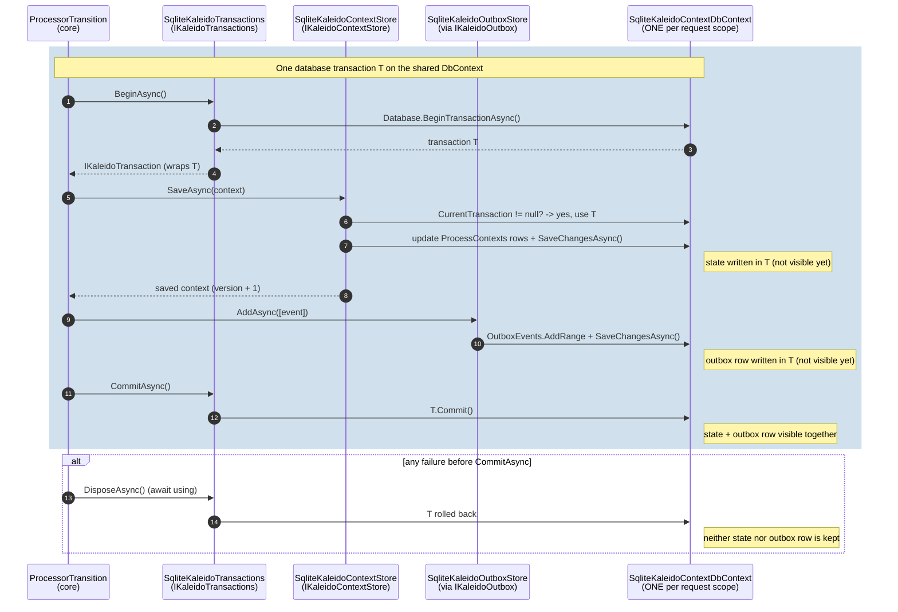

# 0023. Outbox integration: Kaleido owns when, the outbox owns how

- **Status:** Accepted
- **Date:** 2026-10-21
- **Related:** #408, ADR 0012, ADR 0020 (amends its store coupling)

## Context
ADR 0020 split the store contract into three interfaces but kept one coupling:
`IKaleidoContextStore.SaveAsync(context, events)` wrote the events of a save to the outbox itself.
That coupling had four consequences:
- **Fused implementations.** The state store and the outbox were one implementation in disguise:
  every context store had to know the outbox's tables.
- **A second outbox for hosts that already have one.** Most production systems run an outbox already
  (MassTransit, NServiceBus, their own table and dispatcher). They had to run Kaleido's beside it:
  Kaleido's relay always ran, and events existed only when a Kaleido `IEventPublisher` was registered.
- **A heavy contract for other events.** Events outside a save (plan built, query executed) needed the
  whole outbox-store contract, including the relay's claim/complete/fail methods.
- **One SQLite registration.** `UseSqliteKaleidoContextStore` registered state, outbox and
  idempotency together, although idempotency needs no shared transaction.

## Decision
1. **Kaleido owns *when*; the outbox integration owns *how*.** Kaleido decides which events exist and
   which belong to a process-state transition (process created, step completed). The configured
   outbox integration makes them durable and delivers them. Kaleido's runtime depends on no outbox
   table, broker, dispatcher or `DbContext`.
2. **Contracts** (`Kaleido.Storage`):
   - `IKaleidoContextStore`: process state only, `SaveAsync(context)`;
   - `IKaleidoOutbox`: the outbox integration, `AddAsync(events)` and `CommittedAsync()`;
   - `IKaleidoTransactions` / `IKaleidoTransaction`: optional, provided by persistence packages; the
     default does nothing;
   - `IKaleidoOutboxStore`: the storage of Kaleido's built-in outbox, unchanged apart from
     `EnqueueEventsAsync` becoming `AddAsync`; `IKaleidoIdempotencyStore` unchanged.
3. **One transition sequence.** Every process-state save runs, in the internal `ProcessorTransition`:
   begin → `IKaleidoContextStore.SaveAsync` → `IKaleidoOutbox.AddAsync` (the transition's event) →
   commit → `IKaleidoOutbox.CommittedAsync`. A failure before the commit rolls back: neither the
   state nor the event is kept. Events outside a transition are `AddAsync` then `CommittedAsync`,
   without a transaction, and a failure there never fails the request.
4. **Three outbox choices, one per service:**

   | Choice | Registration | Delivery |
   |---|---|---|
   | Kaleido's built-in outbox (default) | `AddKaleido()`; storage `AddOutboxStore<T>()` / `AddSqliteOutboxStore` | the relay claims entries and calls `IEventPublisher`, retrying; durable with durable storage |
   | The host's own outbox | `AddOutbox<T>()` | the host's outbox; Kaleido's outbox store and relay are removed; no `IEventPublisher` needed |
   | Direct publication | `AddDirectPublication()` | published once after the commit; no durability, no retry (weaker, by choice) |

   The built-in outbox and direct publication produce events only when an `IEventPublisher` is
   registered; the host's own outbox always receives them.
5. **Atomic only on one database.** State and events commit together when the context store and the
   outbox write to the database `IKaleidoTransactions` covers: one EF Core `DbContext`, a MongoDB
   session, or a provider's transaction the outbox joins. Across databases each write stands alone.
   No distributed transaction is attempted.
6. **Registration** (`Add*`): `AddContextStore<T>`, `AddIdempotencyStore<T>`, `AddOutboxStore<T>`,
   `AddOutbox<T>`, `AddDirectPublication`, `AddTransactions<T>`. Two implementations of one store
   (`conflicting_store`) or two outbox choices (`conflicting_outbox`) fail at startup.
7. **SQLite** (persistence-specific integration):
   - three registrations on one database (`connection_string_mismatch` otherwise):
     `AddSqliteContextStore`, `AddSqliteOutboxStore` and `AddSqliteIdempotencyStore`;
   - `AddSqliteContextStore` also registers the SQLite transactions (one transaction on the request's
     shared `DbContext`) and `ISqliteKaleidoTransaction`, through which a host's own outbox on the
     same database joins that transaction.

### A step completes (SQLite state, Kaleido's outbox on SQLite)

The context store and the outbox store never call each other. Both write to the same request-scoped
`DbContext`, so EF Core puts both writes in the transaction `ProcessorTransition` begins and commits.
After the commit, `CommittedAsync` wakes the relay, which publishes from the outbox table in its own
scope, retrying across publisher outages and restarts.

## Alternatives considered
- **Keep the context store writing the events** (ADR 0020). This keeps the coupling that made a host's
  existing outbox unusable and every context store outbox-aware. Rejected.
- **Separate outbox database with a prepare/confirm protocol.** It would let the outbox live apart
  from the state: write the event as pending, save the state, confirm, and reconcile pending entries.
  But it costs a third write, a recovery pass and a version check against the context store. Not
  needed: a host's own outbox already lives with its state. Possible later on its own merits.
- **A distributed transaction (2PC/XA).** Unsupported by most modern stores (MongoDB, Kafka) and by
  SQLite. Rejected.
- **The outbox in its own package.** "Convenient default" means it works without an extra package. The
  runtime depends only on `IKaleidoOutbox`, so the built-in outbox stays in `Kaleido`.

## Consequences
- **Breaking (preview).** `IKaleidoContextStore.SaveAsync` loses its `events` parameter;
  `IKaleidoOutboxStore.EnqueueEventsAsync` becomes `AddAsync`; `UseSqliteKaleidoContextStore` becomes
  three registrations. A custom context store stops writing events and, if it shares a database with
  its outbox, registers `IKaleidoTransactions` to stay atomic.
- **Crash safety of the default is unchanged.** It is Kaleido's built-in outbox with durable storage
  and the relay's claims, leases and retries; only who writes a save's event changes.
- **The atomicity is not visible in the stores' code.** It comes from the shared transaction, so this
  ADR, the SQLite README and `SqliteTransitionTests` (integration tests) document and prove it.
- **Consumer guide.** How to choose between the options belongs in the consumer guide (#409).
