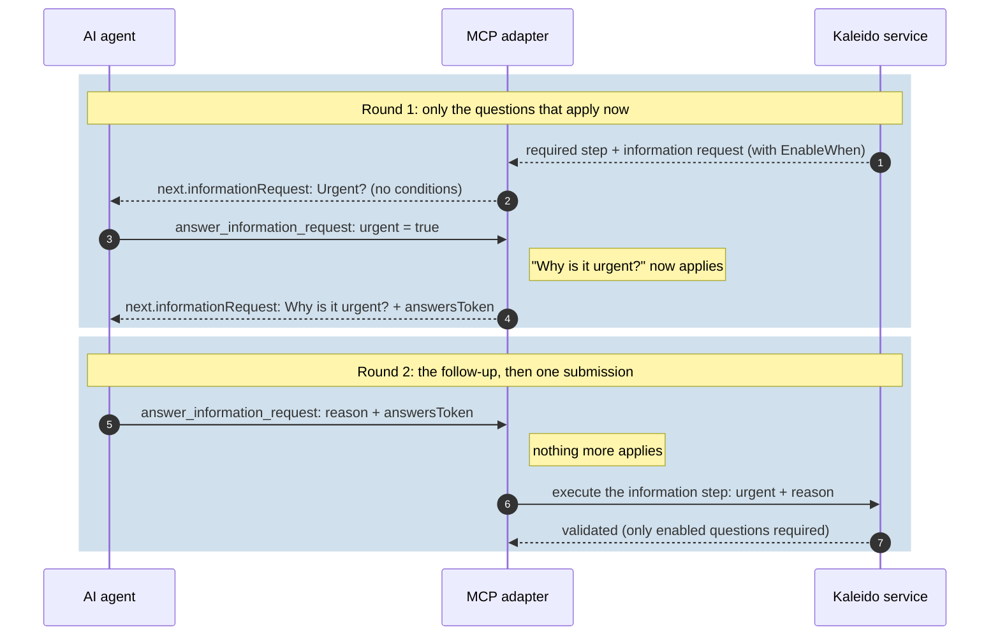

# 0024. Conditional questions: Kaleido decides which questions apply, round by round

- **Status:** Accepted
- **Date:** 2026-10-21
- **Related:** #235, ADR 0002, ADR 0003, ADR 0006, ADR 0007 (amends 0002, 0003 and 0006)

## Context
Clinical questionnaires ask some questions only when an earlier answer says so: "which side?" only
when the body part is not the spine, "for how many weeks?" only when physical therapy was tried. The
PriorAuth configuration already stored such `EnableWhen` conditions, but Kaleido's information
requests had none, so they were dropped and every question was always asked.

A condition depends on an answer that does not exist yet when the request is created. So someone has
to decide, after each answer, which questions come next. The options were:
- the client applies the conditions itself (a UI can; an AI agent would have to be trusted to);
- Kaleido applies them, and hands each asker only the questions that apply now.

## Decision
1. **The contract carries the conditions** (FHIR-style, Kaleido's own schema, ADR 0002):
   `InformationItem.EnableWhen` - a list of `InformationCondition` (`Question`: an earlier question's
   id, `Operator`, `Answer`) - and `EnableBehavior` (`All`, the default, or `Any`). Operators:
   `Exists`, `Equals`, `NotEquals`, `GreaterThan`, `LessThan`, `GreaterThanOrEqual`,
   `LessThanOrEqual`; the ordering operators apply to whole numbers, numbers, dates and date-times.
2. **Semantics.** An item is enabled when its conditions hold and its enclosing group is enabled. A
   condition on an unanswered or disabled question is false, except `Exists` = `false` (the answer of
   a disabled question counts as no answer). With a repeating question, `Equals` and the ordering
   operators hold when any answer matches, and `NotEquals` when none does.
3. **Validation stays structural** (ADR 0006), extended:
   - request: a condition tests an *earlier* question, so conditions never form a cycle; the operator
     fits that question's type, and the value fits the question (`true`/`false` for `Exists`);
   - response: only enabled questions must be answered; an answer to a disabled question is
     `pro_information_response_invalid_answer`.
4. **Kaleido decides what is asked, never the agent.** Whether a question applies is a deterministic
   rule, so it is applied by code (ADR 0007: AI safeguards live in the adapter):
   - **MCP forms** (MRTR and session elicitation) show one round at a time: first the unconditional
     questions, then the ones the answers so far make apply. The answers travel in the continuation
     state, and one complete submission reaches Kaleido.
   - **MCP chat** (`answer_information_request`): `next.informationRequest` lists only the questions
     that apply now, with no condition fields. When the agent's answers make further questions apply,
     they come back with an opaque `answersToken` holding the earlier answers, and nothing is
     submitted yet; otherwise everything is submitted. The agent only ever asks what it is handed.
   - **UIs** apply the same rules to show a question once it applies (the PriorAuth UI does).
5. **Kaleido owns the mechanism, not the content** (ADR 0001, 0003): which conditions a questionnaire
   has is the implementer's configuration; Kaleido only evaluates them.

### A conditional question over MCP chat

With `urgent = false` the follow-up never applies: the first answer is submitted at once.

## Alternatives considered
- **Give the agent the conditions and instruct it to apply them.** Simpler adapter, but an LLM
  applying "only if the body part is not the spine" will sometimes ask a question it should not, or
  skip one it should. Rejected for a deterministic rule.
- **Let Kaleido accept partial answers and re-ask.** It would make the process state carry
  half-answered requests and blur "every question that applies is answered" in validation. The rounds
  belong to the asker; Kaleido receives one complete set.
- **Conditions in the adapter only.** Then validation could not reject an answer to a question that
  does not apply, and every client would need its own copy of the rules. The conditions are part of
  the contract.

## Consequences
- **Additive on the wire.** `enableWhen` and `enableBehavior` are new optional fields; a request
  without conditions behaves exactly as before, over HTTP, MCP and in the UI.
- **Clients that render requests themselves** should hide disabled questions and not send their
  answers (Kaleido rejects them); `InformationRequestExtensions` in core and
  `information-conditions.ts` in the PriorAuth UI implement the same rules.
- **`answersToken` is not a security boundary:** an agent could alter it as it could alter any
  answer; Kaleido validates the complete submission.
- **Handlers** must expect no answer for a disabled question (e.g. the PriorAuth MRI handler reads a
  missing laterality as `None`).
