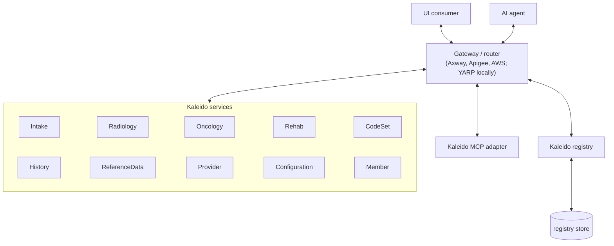

# 0037. One control registry: services push, everyone reads, and the gateway routes

- **Status:** Superseded by 0040
- **Date:** 2026-11-03
- **Related:** #553, #557, #560, #564, #565, #566, #567, ADR 0022, ADR 0036

## Context
Every Kaleido host built its own registry: its own capabilities, plus whatever its configured clients
fetched from the services it knew (`Kaleido:Clients`). With 150+ shared services, several versions of each,
and hosts that must find services they were not configured for (lookups, hand-offs, an agent's tools), that
does not hold:
- **Every host needs every service's address** and its own client configuration for each.
- **Nobody knows what is running.** A registry fetched on demand says what a service publishes, not whether
  any instance of it is up, and a host that cannot reach a service just leaves it out.
- **Each host's view differs** with its configuration, so MCP, a UI and a hand-off can describe different
  things.

## Decision

Arrows show the flow of data. Every call passes the gateway, the registry's included.

1. **One registry, and one shape for it.** `KaleidoRegistry` is the registry everyone speaks: the control
   registry serves it, and every host serves it as it is, filtered for its callers. A host taking part
   (`AddControlRegistryClient()`) builds nothing and merges nothing.
2. **Services push; the registry never calls out.** Each instance registers at startup with its service,
   version, instance id and its own capabilities, heartbeats with its health from local checks only, and
   deregisters at shutdown. It is ready (`kaleido-registration`) once it has registered and read the
   registry; a later failure never makes it not ready.
3. **The registry knows what exists, never where it runs.** No registration carries an address or a host.
   The gateway maps each `/{service}/{version}` route to that version's endpoint from its own
   configuration, deployed with the version as part of the SDLC (with its DNS and load balancer changes).
   No registration can redirect traffic.
4. **Every route carries the version** (`/{service}/{version}/...`, PR 2): what a host describes is what it
   calls, and a process stays on its version because its next steps' URLs carry it. **The current version**
   (the first registered, changed in the registry) only decides where new work starts.
5. **Three documents, one each for consuming, keeping a copy fresh, and operating.**
   - `GET /registry`: the registry in one call, each capability with its version's overall status
     (Available, Degraded, Unknown, Unavailable).
   - `GET /registry/availability`: each version's status and current version, no instances, the
     registry's heartbeat interval, and the capabilities' revision; `GET /registry/capabilities` when that
     revision changes. A host checks the availability at the registry's interval and reads the capabilities
     only when they changed, so a deployment shows everywhere within one check.
   - `GET /registry/status`: every instance, for operations.
6. **The registry sets every pace.** The heartbeat interval comes in each lease; the availability names its
   own. A host configures no interval; with nothing to follow (before its first read, after a failure) it
   retries at 1 s doubling, at most 30 s. A host's snapshot is rebuilt exactly when the registry's revision
   changes.
7. **Trust is the identity provider's.** Registering needs `RegistrantPolicy` (an app-only token, never a
   user's) and the app role naming the service (`Kaleido.Registrant.{service}`), or the optional
   `Registrants` map. `GET /registry` is unfiltered for a Kaleido host (`ReaderPolicy`) and filtered for
   anyone else to what they may use, by each capability's published authorization; the other reads are the
   hosts' only. Filtering is discovery: every service still enforces its own authorization. A policy the
   filtering host does not define hides the capabilities naming it.
8. **The registry's state is its store's, and its nodes hold none.** Several nodes share one store
   (SQLite for development, the host's own for production). Every state is worked out on read from what
   instances reported; after all nodes were down, old instances are Unknown for one lease, the registry
   serves throughout, and nothing is swept until it has been up for a whole retention period.

## Alternatives considered
- **Each host keeps fanning out to its clients.** Every host needs every address, and no host knows what is
  running. Rejected.
- **The registry polls the services.** It would need every address, and a registry outage would look like
  every service failing. Pushed heartbeats keep the registry ignorant of addresses.
- **Addresses in the registry, a Kaleido router reading them.** A registration could then redirect traffic,
  and two places would hold where each version runs. The gateway already routes and is configured with each
  deployment; YARP stays for local development and the samples.
- **An unversioned route to the current version.** Hosts switching at different moments could describe one
  version and call another, and a running process could land on a version without its state.
- **A host-configured capabilities interval.** A new deployment would show its status before its
  capabilities, for up to that interval; the capabilities' revision in the availability makes them arrive
  together.
- **A user-facing registry served by another host.** One endpoint, filtered for whoever asks, needs no extra
  host and serves the UI as it serves an agent through MCP.

## Consequences
- **One registry to read**, the same on every host and for every caller, filtered for them.
- **A service configures one address**, the gateway's (`Kaleido:Registry:Url`), and its version is
  required (PR 2 makes `ServiceVersion` required everywhere).
- **Deploying a version is a gateway change too**, made in the same release.
- **The registry host defines the policies the capabilities name**, as MCP hosts do (#565).
- **Heartbeats and availability checks pass the gateway**: about two calls per instance per interval,
  which its limits must allow.
- **Follow-ups:** versioned routes and the required version (PR 2); wording overrides and the admin UI
  (PR 3); MCP marking unavailable tools (#567); hardening (#566); endpoint descriptions everywhere (#564);
  a transport-neutral registry with per-transport bindings (#557, #560).
