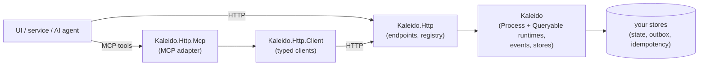

# Kaleido consumer guide

How Kaleido works end to end, and how to choose between its options. This guide is organized by
concept; it links to the reference pages (`docs/*.md`), the project READMEs and the decision records
(`docs/decisions`) for the details, instead of repeating them.

> **Support status: preview.** Kaleido is pre-1.0. Public APIs and wire contracts can still change
> between previews; breaking changes are listed in the [CHANGELOG](../../CHANGELOG.md). See
> [VERSIONING](../VERSIONING.md).

## What Kaleido is

A framework for **business services that tell their callers what to do next**. A service publishes
what it knows (**queries**) and what it can do (**process steps**). Every step's answer says what is
required or available next, so a UI, another service or an AI agent can follow the process without
hard-coding it. Kaleido is a process engine, never a business decision maker
([ADR 0001](../decisions/0001-process-engine-not-decision-maker.md)): your handlers decide; Kaleido
applies the rules you declared and records what happened.

## Reading order

| Page | What you learn |
|---|---|
| [Getting started](getting-started.md) | A service from zero: a query source, two steps, HTTP, then MCP |
| [Processes](processes.md) | Steps, handlers, relationships, outcomes, versions |
| [Queries](queries.md) | Sources, views, query contexts, paging and counting, delegated sources |
| [Information requests](information-requests.md) | Questions decided at runtime, conditional questions |
| [Callers and correlation](callers-and-correlation.md) | Authorization, call credentials, request and process ids across services |
| [Events and the outbox](events-and-outbox.md) | Which events exist, when they are written, the delivery guarantees |
| [Persistence](persistence.md) | The store contracts, the defaults, SQLite, your own store, atomicity |
| [Deployment](deployment.md) | Several instances, schemas, health, what to monitor |
| [Choosing options](choosing-options.md) | Decision tables for every `Add*` registration |

Every C# example is one **orders** service that grows page by page. It is compiled
(`docs/guide/examples`, under Kaleido's consumer analyzers), each block on a page is checked against
it in CI (`tools/docs/check-guide-snippets.py`), and what each page states is run by a test
(`tests/Kaleido.IntegrationTests/Guide`).
