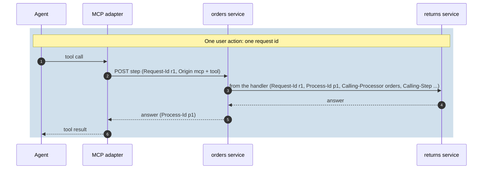

# Callers and correlation

Who may call what, which credential a service uses when it calls another one, and how one user
action is followed across services. The examples continue the orders service
(`docs/guide/examples/Callers`); a test runs the authorization rules.

## Authentication is the host's; authorization is declared

Kaleido never authenticates: the host does (`AddAuthentication`, JWT, cookies), and Kaleido reads the
resulting principal. Each step, source and view is a **capability**, and `AuthorizationMode` says
what a capability without a rule means:

| Mode | A capability without a rule | Roles / policy rules |
|---|---|---|
| `None` | open | not enforced (local evaluation only) |
| `Authenticated` (default) | any signed-in caller | enforced |
| `ZeroTrust` | not published, not callable | enforced |

<!-- snippet: callers-rule -->
```csharp
// Only managers may refund. The other capabilities have no rule: under the default mode
// (Authenticated) any signed-in caller may use them.
[ProcessStep(
    DisplayName = "Refund order",
    Description = "Refunds the shipped order.",
    Destructive = true,
    External = true)]
[AvailableAfter<ShipOrderStep>]
[KaleidoAuthorization(Roles = "manager")]
public sealed record RefundOrderStep : IProcessStep;
```

What the test shows, under `Authenticated`:

| Caller | Registry | Calls |
|---|---|---|
| anonymous | - | **401** |
| signed in, role `clerk` | every step and source, **without** Refund order | Refund order: **403** |
| signed in, role `manager` | everything, Refund order included | Refund order runs |

The MCP adapter builds each caller's tools from that caller's registry. The full rule table
(`Roles`, `Policy`, `AllowAnonymous`, a service default): [AUTHORIZATION](../AUTHORIZATION.md),
[ADR 0021](../decisions/0021-authenticated-by-default.md).

**A process id is not a permission.** Any caller the capability rules admit, holding a process id, can
continue that process (the test: Ben confirms Ann's order); Kaleido has no case-level guardrails
([ADR 0010](../decisions/0010-no-case-level-guardrails.md)). Which records a caller may touch is your
handlers' and sources' job: [Queries - Who may query, and which rows](queries.md#who-may-query-and-which-rows),
[threat model](../AUTHORIZATION.md#threat-model-the-process-id-is-a-bearer-handle).

## Which token a service sends

When a service calls another Kaleido service (a handler or delegated source using a Kaleido client,
the MCP adapter calling for a user), a call made **for a caller** and the service's **own** calls
(registry refresh, heartbeat, health probe) carry different tokens (#574,
[client README](../../src/Kaleido.Http.Client/README.md)). A call made for a caller is set by
`Kaleido:OnBehalfOfCalls`, a setting, not a token:

| `Kaleido:OnBehalfOfCalls` | A call made for a caller carries | The service's own calls carry |
|---|---|---|
| `Forward` (default) | the caller's token, unchanged | what your handlers set, e.g. a client-credentials token |
| `Exchange` (required on an MCP host) | the token your handler exchanged for the caller, never the inbound one | the same |

An anonymous caller's calls carry nothing, whatever your handlers set. Your handlers are standard
`DelegatingHandler`s on the Kaleido clients, from any library; `KaleidoCallContext.Of(request)` tells
them which call it is and gives them the caller's token to exchange:

<!-- snippet: callers-credentials -->
```csharp
// A standard DelegatingHandler on the Kaleido clients: for a call made for a caller, the caller's token
// exchanged for one the services accept. Kaleido tells it which call it is; the service's own calls are
// left to the host's other handlers (e.g. a client-credentials token).
public sealed class TokenExchangeHandler(ITokenExchange exchange) : DelegatingHandler
{
    protected override async Task<HttpResponseMessage> SendAsync(HttpRequestMessage request, CancellationToken cancellationToken)
    {
        var call = KaleidoCallContext.Of(request);

        if (call.Purpose == KaleidoCallPurpose.OnBehalfOfCaller && call.CallerAuthorization is { } authorization)
        {
            request.Headers.Remove("Authorization");
            request.Headers.TryAddWithoutValidation("Authorization", await exchange.ExchangeAsync(authorization, cancellationToken));
        }

        return await base.SendAsync(request, cancellationToken);
    }
}
```

<!-- snippet: callers-credentials-registration -->
```csharp
// Kaleido:OnBehalfOfCalls = Exchange in configuration: a caller's call never carries the inbound token.
services.AddKaleido(configuration, new() { ServiceName = "orders", Assemblies = [typeof(TokenExchangeHandler).Assembly] })
    .AddHttpClients()
    .AddKaleidoClientHandler<TokenExchangeHandler>();
```

With `Exchange`, a call for a caller that carries no token, or the inbound one unchanged, is refused
before it is sent (`httpclient_caller_token_not_exchanged`).

## Following one action across services

Every call carries correlation headers; Kaleido reads them on the way in, passes them to your handlers
and sources, stamps them on the way out, and puts them on logs, traces and events
([CORRELATION](../CORRELATION.md)):



| Header | Kind | Meaning |
|---|---|---|
| `X-Kaleido-Request-Id` | end to end | the user action; generated when missing |
| `X-Kaleido-Process-Id` | end to end | the process the call belongs to |
| `X-Kaleido-Origin` / `X-Kaleido-Origin-Tool` | end to end | the front door (`mcp`) and the tool; informational, never an authorization input |
| `X-Kaleido-Calling-Processor` / `X-Kaleido-Calling-Step` | this hop | the step that made the call |

The caller's identity is never read from headers: it comes from the authenticated principal, and
handlers and sources read it from `IKaleidoCorrelationContextAccessor` (`CallerName`, `CallerId`,
`CallerActor`). Who may do what is ASP.NET's authorization, on the principal itself.
