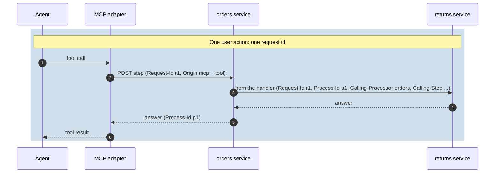

# Callers and correlation

Who may call what, which credential a service uses when it calls another one, and how one user
action is followed across services. The examples continue the orders service
(`docs/guide/examples/Callers`); a test runs the authorization rules.

## Authentication is the host's; authorization is declared

Kaleido never authenticates: the host does (`AddAuthentication`, JWT, cookies), and Kaleido reads the
resulting principal. Each step, source and view is a **capability**, and `AuthorizationMode` says
what a capability without a rule means:

| Mode | A capability without a rule | Roles / policy rules |
|---|---|---|
| `None` | open | not enforced (local evaluation only) |
| `Authenticated` (default) | any signed-in caller | enforced |
| `ZeroTrust` | not published, not callable | enforced |

<!-- snippet: callers-rule -->
```csharp
// Only managers may refund. The other capabilities have no rule: under the default mode
// (Authenticated) any signed-in caller may use them.
[ProcessStep(
    Version = "1.0.0",
    DisplayName = "Refund order",
    Description = "Refunds the shipped order.",
    Destructive = true,
    External = true)]
[AvailableAfter<ShipOrderStep>]
[KaleidoAuthorization(Roles = "manager")]
public sealed record RefundOrderStep : IProcessStep;
```

What the test shows, under `Authenticated`:

| Caller | Registry | Calls |
|---|---|---|
| anonymous | - | **401** |
| signed in, role `clerk` | every step and source, **without** Refund order | Refund order: **403** |
| signed in, role `manager` | everything, Refund order included | Refund order runs |

The MCP adapter builds each caller's tools from that caller's registry. The full rule table
(`Roles`, `Policy`, `AllowAnonymous`, a service default): [AUTHORIZATION](../AUTHORIZATION.md),
[ADR 0021](../decisions/0021-authenticated-by-default.md).

**A process id is not a permission.** Any caller the capability rules admit, holding a process id, can
continue that process (the test: Ben confirms Ann's order); Kaleido has no case-level guardrails
([ADR 0010](../decisions/0010-no-case-level-guardrails.md)). Which records a caller may touch is your
handlers' and sources' job: [Queries - Who may query, and which rows](queries.md#who-may-query-and-which-rows),
[threat model](../AUTHORIZATION.md#threat-model-the-process-id-is-a-bearer-handle).

## Which credential a service sends

When a service calls another Kaleido service (a handler or delegated source using a Kaleido client,
the MCP adapter calling for a user), a call made **for a caller** and the service's **own** calls
(registry refresh, health probe) can carry different credentials
([ADR 0022](../decisions/0022-call-credentials.md), [client README](../../src/Kaleido.Http.Client/README.md)):

| Registration | A call made for a caller carries | The service's own calls carry |
|---|---|---|
| (default) | the service's credential, configured on its HTTP client | the same |
| `ForwardCallerToken()` | the caller's token, unchanged | the service's credential |
| `AddCallCredentials<T>()` | what your provider returns | what your provider returns |

<!-- snippet: callers-credentials -->
```csharp
// Decides the credential of every call this service makes to another Kaleido service.
public sealed class OnBehalfOfCredentials(ITokenExchange exchange) : IKaleidoCallCredentialProvider
{
    public async ValueTask<KaleidoCallCredential> GetCredentialAsync(
        KaleidoCallCredentialRequest request,
        CancellationToken cancellationToken)
    {
        // A call made for a caller: exchange the caller's token for one the target service accepts.
        if (request.Purpose == KaleidoCallPurpose.OnBehalfOfCaller && request.CallerAuthorization is { } authorization)
        {
            return KaleidoCallCredential.Header(await exchange.ExchangeAsync(authorization, request.ServiceName, cancellationToken));
        }

        // The service's own calls (registry refresh, health probe): its configured credential.
        return KaleidoCallCredential.Configured;
    }
}
```

<!-- snippet: callers-credentials-registration -->
```csharp
services.AddKaleido(configuration, o =>
    {
        o.ServiceName = "orders";
        o.Assemblies = [typeof(OnBehalfOfCredentials).Assembly];
    })
    .AddHttp()
    .AddHttpClients()
    .AddCallCredentials<OnBehalfOfCredentials>();   // or .ForwardCallerToken(): the caller's token, unchanged
```

## Following one action across services

Every call carries correlation headers; Kaleido reads them on the way in, passes them to your handlers
and sources, stamps them on the way out, and puts them on logs, traces and events
([CORRELATION](../CORRELATION.md)):



| Header | Kind | Meaning |
|---|---|---|
| `X-Kaleido-Request-Id` | end to end | the user action; generated when missing |
| `X-Kaleido-Process-Id` | end to end | the process the call belongs to |
| `X-Kaleido-Origin` / `X-Kaleido-Origin-Tool` | end to end | the front door (`mcp`) and the tool; informational, never an authorization input |
| `X-Kaleido-Calling-Processor` / `X-Kaleido-Calling-Step` | this hop | the step that made the call |

The caller's identity is never read from headers: it comes from the authenticated principal, and
handlers and sources read it from `IKaleidoCorrelationContextAccessor` (`CallerName`, `CallerId`,
`CallerRoles`).
