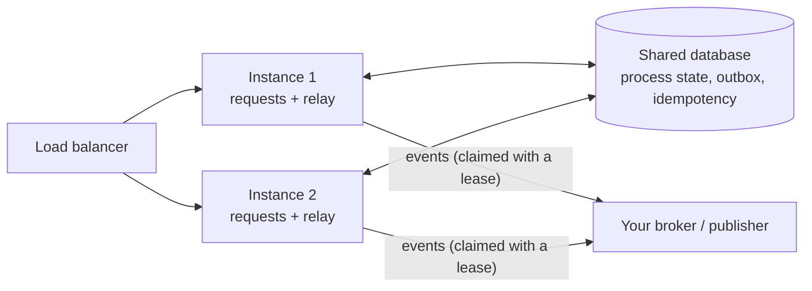

# Deployment

Running a Kaleido service for real: several instances, the database schema, health, and what to
watch. The wiring examples are compiled (`docs/guide/examples/Deployment`).

## Several instances

Kaleido keeps no state in the instance once the stores are durable, so instances can be added and
removed freely. They share the database:



The gateway maps `/{service}/{version}` to the host pool of that version; one service host maps
only its own version. Deploy each gateway mapping with its version and keep the older mapping
while its processes still need to run. The registry publishes logical routes and status, never
instance addresses ([ADR 0040](../decisions/0040-central-registry-only-and-versioned-routes.md)).

| Concern | How it stays correct |
|---|---|
| Two calls for one process on two instances | the state is saved conditionally on its version: the second gets **409** `pro_process_conflict` and can retry on the new state |
| A retried call on another instance | the idempotency record is in the shared store, so the retry is answered from it |
| Every instance runs the event relay | events are **claimed with a lease**: one instance publishes each; a crashed instance's claims expire and are taken over (at least once) |
| In-memory stores | each instance sees only its own processes and events: **not** for several instances |
| An MCP form (a guided lookup, an answers or confirmation form) or an `answersToken` answered on another instance | the state is protected with ASP.NET Data Protection: the instances must share one key ring ([below](#mcp-on-several-instances-one-key-ring)), or the form is refused and the user searches again |
| Registry on several nodes | the store is authoritative; each node's HybridCache keeps a short-lived merged view and revisioned capabilities. `IDistributedCache` is optional on the registry host, with a store fallback if it fails ([registry cache](../../src/Registry/Registry/README.md#cache-kaleidoregistrycache)) |

### MCP on several instances: one key ring

When the MCP adapter asks the user to search for a record and pick it (a guided lookup with forms),
the search results travel to the client and back between the forms, encrypted and signed with ASP.NET
Data Protection; so do the state of every answers or confirmation form and the `answersToken` (#516) ([MCP README](../../src/Mcp/Mcp/README.md#lookups)). The answer to a form can
reach another instance than the one that showed it, so every instance needs the same keys - the same
**application name** and the same **key storage**:

<!-- snippet: deployment-key-ring -->
```csharp
// Every instance: the same application name and the same key storage. A folder every instance
// mounts works as is; packages store the keys in Redis, Azure Blob Storage or a database
// (PersistKeysToStackExchangeRedis, PersistKeysToAzureBlobStorage, PersistKeysToDbContext).
services.AddDataProtection()
    .SetApplicationName("orders")
    .PersistKeysToFileSystem(sharedKeys);
```

- Protect the stored keys at rest as your platform recommends (`ProtectKeysWithCertificate`,
  `ProtectKeysWithAzureKeyVault`...); they are the host's, not Kaleido's.
- A single instance needs nothing, and neither does Azure App Service, which shares its default key
  location between the instances of an app.
- **How you know it is wrong:** outside Development, a host that configured no key storage logs a
  Warning at startup ("no Data Protection key storage is configured"). When a form is answered on an
  instance that lacks its key, that instance logs a Warning ("the MCP instances ... do not share one
  key ring"), counts it in `kaleido.mcp.states_refused` with reason `unknown_key` and the state's kind,
  and tells the user to start again. Nothing runs.

## The database schema

Kaleido never creates or migrates your schema. With your own stores it is yours (migrations as usual).
With the SQLite reference provider, the host creates it once at startup (`EnsureCreatedAsync`), and it
is never migrated ([provider README](../../src/Providers/Provider.SQLite/README.md)).

## Health

| Check | Registered by |
|---|---|
| The outbox (`kaleido-outbox`): a relay was seen draining it within `Kaleido:Events:RelaySeenWithin`, and no backlog (oldest due event within `BacklogMaxAge`, at most `BacklogMaxCount` due); `Degraded` otherwise (`OutboxHealthFailureStatus`) | `AddKaleido()`, every service ([Events and the outbox](events-and-outbox.md#is-a-relay-running)) |
| Initial registration and central read (`kaleido-registration`) | `AddControlRegistryClient()`; stays ready after its first successful registration/read ([client README](../../src/Http/Http.Client/README.md#taking-part-in-the-control-registry)) |
| Registry store (`kaleido-registry-store`) and expected versions (`kaleido-registry-completeness`) | `AddControlRegistry()` on the registry host |
| Your database | you (the SQLite provider registers none) |

<!-- snippet: deployment-health -->
```csharp
// AddControlRegistryClient() adds kaleido-registration; no client probes another service.
// Your database is yours to check.
services.AddHealthChecks()
    .AddDbContextCheck<OrdersDbContext>("orders-database");
```

<!-- snippet: deployment-health-map -->
```csharp
app.MapHealthChecks("/health");
```

There are no downstream client health probes. A dependency's availability comes from that
service version's registry heartbeat; a registry outage after this host's first read does not
pull it out of readiness.

## What to monitor

Kaleido instruments with .NET `ActivitySource` and `Meter`. `AddOpenTelemetry()`
([`Kaleido.Observability.OpenTelemetry`](../../src/Observability/Observability.OpenTelemetry/README.md))
exports them; any other listener works too.

<!-- snippet: deployment-telemetry -->
```csharp
kaleido.AddOpenTelemetry();   // export target under Kaleido:OpenTelemetry in configuration
```

| Meter | Watch |
|---|---|
| `Kaleido.Processor` | `kaleido.processor.execution_failures`, `kaleido.processor.step_failures`, `kaleido.processor.execution.duration` |
| `Kaleido.Queryable` | `kaleido.queryable.execution_failures`, `kaleido.queryable.execution.duration` |
| `Kaleido.Events` | `kaleido.events.failed` (publishing retries), `kaleido.events.parked` (gave up: needs a person), `kaleido.events.enqueue_failures` (events lost) |
| `Kaleido.Mcp` | `kaleido.mcp.tool_calls` by outcome (`completed`, `input_required`, `refused` - the caller's request was refused, not an error span - `error`, `canceled`) and `kaleido.error.code` (one of the adapter's tool-call codes), `kaleido.mcp.tool_call.duration`, `kaleido.mcp.states_refused` by kind and reason (`unknown_key`: the instances do not share a key ring) |

Logs follow one rule: Information is a few lines per request; caller errors (400, 401, 403, 409) are
Warnings, logged once; Errors are failures of the service. Every log, span and event carries the
request id and process id ([Callers and correlation](callers-and-correlation.md)).

## Before production

- Durable stores for state, outbox and idempotency ([Persistence](persistence.md)).
- A relay for every outbox database: `AddOutboxRelay<TPublisher>()` with your `IEventPublisher`, on one of the services or a host with nothing else ([Events and the outbox](events-and-outbox.md)).
- Authentication, and `Authenticated` or `ZeroTrust` ([Callers and correlation](callers-and-correlation.md)).
- An event redaction policy for classified fields.
- Alerts on parked events and enqueue failures.
- With the MCP adapter on several instances, one Data Protection key ring for all of them
  ([above](#mcp-on-several-instances-one-key-ring)).
