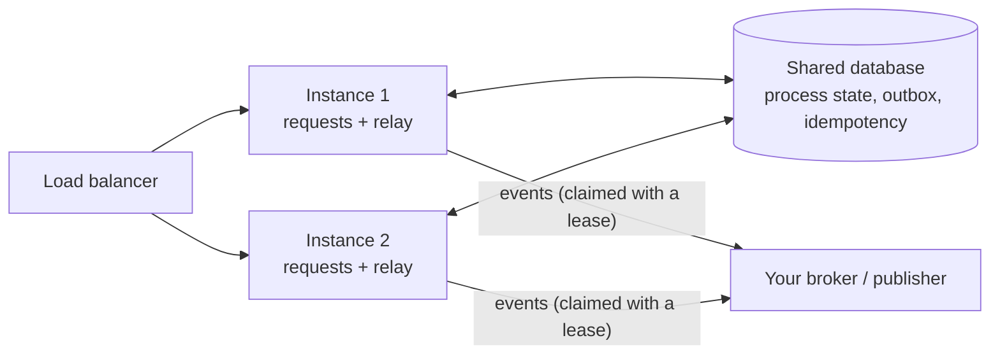

# Deployment

Running a Kaleido service for real: several instances, the database schema, health, and what to
watch. The wiring examples are compiled (`docs/guide/examples/Deployment`).

## Several instances

Kaleido keeps no state in the instance once the stores are durable, so instances can be added and
removed freely. They share the database:



| Concern | How it stays correct |
|---|---|
| Two calls for one process on two instances | the state is saved conditionally on its version: the second gets **409** `pro_process_conflict` and can retry on the new state |
| A retried call on another instance | the idempotency record is in the shared store, so the retry is answered from it |
| Every instance runs the event relay | events are **claimed with a lease**: one instance publishes each; a crashed instance's claims expire and are taken over (at least once) |
| In-memory stores | each instance sees only its own processes and events: **not** for several instances |

## The database schema

Kaleido never creates or migrates your schema. With your own stores it is yours (migrations as usual).
With the SQLite reference provider, the host creates it once at startup (`EnsureCreatedAsync`), and it
is never migrated ([provider README](../../src/Kaleido.Provider.SQLite/README.md)).

## Health

| Check | Registered by |
|---|---|
| Each downstream Kaleido service (`kaleido-{name}`, probes its registry) | `AddHttpClients()` ([client README](../../src/Kaleido.Http.Client/README.md)) |
| Your database | you (the SQLite provider registers none) |

<!-- snippet: deployment-health -->
```csharp
// Downstream Kaleido services are checked by AddHttpClients() (kaleido-{name}); your database
// is yours to check.
services.AddHealthChecks()
    .AddDbContextCheck<OrdersDbContext>("orders-database");
```

<!-- snippet: deployment-health-map -->
```csharp
app.MapHealthChecks("/health");
```

A Kaleido client health check is never retried and has its own short timeout, so it reports honestly.

## What to monitor

Kaleido instruments with .NET `ActivitySource` and `Meter`. `AddOpenTelemetry()`
([`Kaleido.Observability.OpenTelemetry`](../../src/Kaleido.Observability.OpenTelemetry/README.md))
exports them; any other listener works too.

<!-- snippet: deployment-telemetry -->
```csharp
kaleido.AddOpenTelemetry();   // export target under Kaleido:OpenTelemetry in configuration
```

| Meter | Watch |
|---|---|
| `Kaleido.Processor` | `kaleido.processor.execution_failures`, `kaleido.processor.step_failures`, `kaleido.processor.execution.duration` |
| `Kaleido.Queryable` | `kaleido.queryable.execution_failures`, `kaleido.queryable.execution.duration` |
| `Kaleido.Events` | `kaleido.events.failed` (publishing retries), `kaleido.events.parked` (gave up: needs a person), `kaleido.events.enqueue_failures` (events lost) |
| `Kaleido.Http.Mcp` | `kaleido.mcp.tool_calls` by outcome, `kaleido.mcp.tool_call.duration` |

Logs follow one rule: Information is a few lines per request; caller errors (400, 401, 403, 409) are
Warnings, logged once; Errors are failures of the service. Every log, span and event carries the
request id and process id ([Callers and correlation](callers-and-correlation.md)).

## Before production

- Durable stores for state, outbox and idempotency ([Persistence](persistence.md)).
- An `IEventPublisher`, or your own outbox ([Events and the outbox](events-and-outbox.md)).
- Authentication, and `Authenticated` or `ZeroTrust` ([Callers and correlation](callers-and-correlation.md)).
- An event redaction policy for classified fields.
- Alerts on parked events and enqueue failures.
