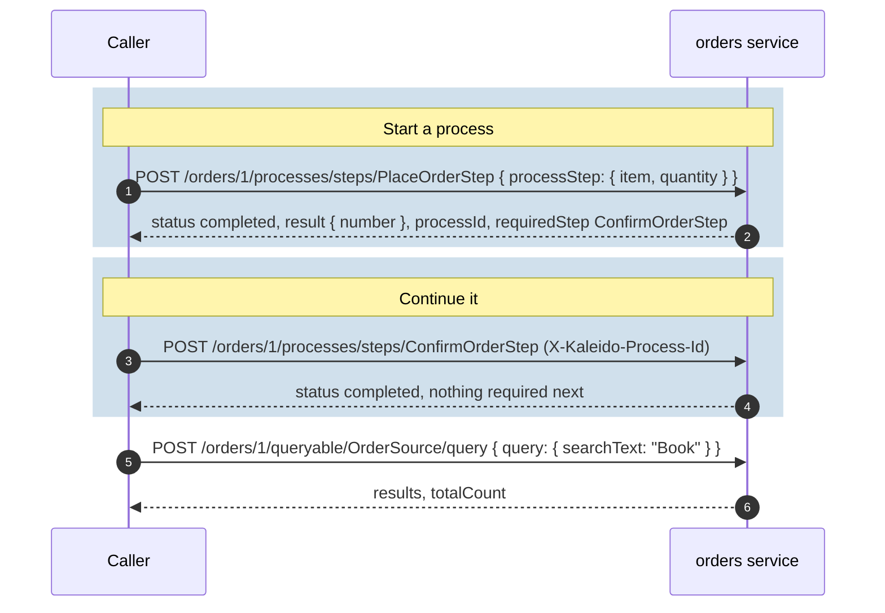

# Getting started

A small **orders** service from zero: a query source (what the service knows), two process steps
(what it can do), published over HTTP, then to AI agents over MCP. The code is the guide's compiled
example (`docs/guide/examples/GettingStarted`); a test runs it as shown here.

## 1. The data

In a real service this is your database; here, a list in memory:

<!-- snippet: getting-started-store -->
```csharp
// The orders themselves: in a real service, your database.
public sealed class OrderBook
{
    private readonly ConcurrentDictionary<int, OrderQueryContext> _orders = new();
    private int _lastNumber;

    public IEnumerable<OrderQueryContext> All => _orders.Values;

    public int Place(string item, int quantity)
    {
        var number = Interlocked.Increment(ref _lastNumber);
        _orders[number] = new OrderQueryContext { Number = number, Item = item, Quantity = quantity };
        return number;
    }
}
```

## 2. A query source

A **query context** describes what callers may ask: which fields they can filter, search and sort
by. The **source** returns an `IQueryable` of it; Kaleido applies the caller's filters, search, sort
and paging. Descriptions are published in the registry, which is what UIs and agents read (KAL2015).

<!-- snippet: getting-started-source -->
```csharp
// What can be asked about orders: the query context declares what is filterable, searchable and
// sortable; the source says where the data comes from.
public sealed record OrderQueryContext : IQueryContext
{
    [Description("The order number.")]
    [Filterable(FilterOperator.Equals)]
    [Sortable]
    public int Number { get; init; }

    [Description("What was ordered.")]
    [Searchable(Priority = 1, MatchMode = MatchMode.Contains)]
    public string Item { get; init; } = string.Empty;

    [Description("How many were ordered.")]
    public int Quantity { get; init; }
}

[QuerySource(
    DisplayName = "Orders",
    Description = "The orders placed in the shop.",
    DefaultSortField = nameof(OrderQueryContext.Number))]
[Pageable(DefaultSize = 20, MaxSize = 100)]
public sealed class OrderSource(OrderBook orders) : IQuerySource<OrderQueryContext>
{
    public IQueryable<OrderQueryContext> CreateQuery(QueryExecutionContext executionContext) =>
        orders.All.AsQueryable();
}
```

## 3. Two process steps

A **step** is a business action: a record of its inputs (validated with data annotations) and a
**handler** that does the work. The handler's result says what comes next: here, placing an order
requires the confirmation. `[DependsOn<PlaceOrderStep>]` makes confirming impossible before an order
exists. See [Processes](processes.md).

<!-- snippet: getting-started-steps -->
```csharp
// What can be done: placing an order starts a process; confirming it is the next step.
[ProcessStep(
    DisplayName = "Place order",
    Description = "Places an order for an item.")]
public sealed record PlaceOrderStep : IProcessStep
{
    [Required]
    [Description("What to order.")]
    public required string Item { get; init; }

    [Range(1, 10)]
    [Description("How many to order, from 1 to 10.")]
    public int Quantity { get; init; } = 1;
}

public sealed record PlacedOrder
{
    [Description("The number of the order placed.")]
    public int Number { get; init; }
}

public sealed class PlaceOrderHandler(OrderBook orders) : IProcessStepHandler<PlaceOrderStep, PlacedOrder>
{
    public Task<ProcessStepHandlerResult<PlacedOrder>> ExecuteAsync(
        PlaceOrderStep processStep,
        ProcessStepContext context,
        CancellationToken cancellationToken) =>
        Task.FromResult(
            ProcessStepHandlerResult
                .Success(new PlacedOrder { Number = orders.Place(processStep.Item, processStep.Quantity) })
                .Next<ConfirmOrderStep>());
}

[ProcessStep(
    DisplayName = "Confirm order",
    Description = "Confirms the order placed in this process.",
    RequiresConfirmation = true)]
[DependsOn<PlaceOrderStep>]
public sealed record ConfirmOrderStep : IProcessStep;

public sealed class ConfirmOrderHandler : IProcessStepHandler<ConfirmOrderStep>
{
    public Task<ProcessStepHandlerResult> ExecuteAsync(
        ConfirmOrderStep processStep,
        ProcessStepContext context,
        CancellationToken cancellationToken) =>
        Task.FromResult(ProcessStepHandlerResult.Success());
}
```

## 4. Publish it over HTTP

Run a separate [control registry host](../../src/Capabilities/Registry/Kaleido.Registry.Server/README.md#a-registry-host) and
configure `Kaleido:BaseUrl` with the gateway's URL. Map `/registry` to the registry host and
`/orders/1` to the Orders host; the registry carries logical routes, never host addresses.
Register Kaleido with the assemblies to scan, then map its endpoints. Kaleido finds the source,
steps and handlers and checks them at startup (a step without a handler, a broken relationship
or missing metadata fails before the first request).

<!-- snippet: getting-started-host -->
```csharp
services.AddSingleton<OrderBook>();

services.AddKaleido(configuration, new()
{
    ServiceName = "orders",
    ServiceVersion = "1",
    Assemblies = [typeof(OrderSource).Assembly],
})
    .AddEventing()
    .AddProcess()
    .AddQueryable()
    .AddServer(new() { AuthorizationMode = KaleidoAuthorizationMode.None }) // local evaluation only
    .AddInMemoryProviders()   // local evaluation only: nothing survives a restart
    .AddHttp()
    .AddProcessHttpServer()
    .AddProcessHttpBindings()
    .AddQueryableHttpBindings()
    .AddRegistryHttpParticipation()
    .AddProcessHttpClient();
```

`AddKaleido()` installs only the foundation; `AddEventing()` installs the outbox-backed writer, `AddProcess()`/`AddQueryable()` register their runtimes, and `AddServer()` configures authorization. `AddInMemoryProviders()` explicitly chooses process state, idempotency records and an event outbox that live in this process and are lost on restart. Without a choice the host does not start (`stores_not_chosen`): a service
never keeps them in memory by accident. A deployed service registers durable stores instead
([Persistence](persistence.md), [ADR 0028](../decisions/0028-stores-are-chosen-explicitly.md)).

<!-- snippet: getting-started-map -->
```csharp
endpoints.MapKaleido().MapProcess().MapQueryable();
```

The composition maps local endpoints only. This service also opts into Registry participation to publish its HTTP bindings and adds the Process HTTP client for the later cross-service return hand-off; a local-only service needs neither. A dedicated Registry authority uses `app.MapKaleido().MapCentralRegistry()` instead. See the [HTTP hosting README](../../src/Composed/Hosts/Kaleido.Hosting.Http/README.md) for the separate host roles.

> `AuthorizationMode.None` leaves every capability open, for local evaluation. The default is
> `Authenticated`; see [Callers and correlation](callers-and-correlation.md).

## 5. Call it



- **Place an order:** `POST /orders/1/processes/steps/PlaceOrderStep` with
  `{ "processStep": { "item": "Book", "quantity": 2 } }`. The answer carries the new `processId`, the
  handler's `result`, and `requiredStep`: the step to call next.
- **Continue the process:** `POST /orders/1/processes/steps/ConfirmOrderStep`, with the process id in
  the `X-Kaleido-Process-Id` header.
- **Query the orders:** `POST /orders/1/queryable/OrderSource/query` with
  `{ "query": { "searchText": "Book" } }`, or a `filter`, `sort` and `page`
  ([Queries](queries.md#the-query-a-caller-sends)).
- **Discover everything:** `GET /registry` on the separate registry host lists the steps, sources,
  versioned routes, inputs and descriptions (filtered for the caller). Kaleido hosts keep an
  unfiltered copy fresh from `/registry/availability` and revisioned `/registry/capabilities`.

The routes, the body shapes and the error answers are in the
[`Kaleido.Http.Server` README](../../src/Capabilities/Process/Kaleido.Process.Http.Server/README.md).

## 6. Publish it to AI agents (MCP)

The MCP adapter presents the central Registry's caller-filtered tools and calls services through
the current Process/Queryable clients with exchanged user credentials. A reader-only MCP host can
present several registered services without registering local runtimes or per-service client URLs.
The publishing services separately register `AddRegistryHttpParticipation()`, HTTP bindings, and
explicit `MapProcess()`/`MapQueryable()` routes ([MCP README](../../src/Mcp/Mcp/README.md)).

<!-- snippet: getting-started-mcp -->
```csharp
services.AddAuthentication("Bearer").AddJwtBearer(options =>
{
    options.Authority = configuration["Authentication:Authority"];
    options.Audience = configuration["Authentication:Audience"];
});
services.AddAuthorization();

services.AddKaleido(configuration, new()
{
    ServiceName = "mcp-reader",
    ServiceVersion = "1",
    Assemblies = [typeof(OrderSource).Assembly],
    TypeFilter = _ => false,
})
    .AddServer(new() { AuthorizationMode = KaleidoAuthorizationMode.Authenticated })
    .AddHttp()
    .AddKaleidoClientHandler<TokenExchangeHandler>()
    .AddRegistryHttpParticipation(new() { OnBehalfOfCalls = KaleidoOnBehalfOfCalls.Exchange })
    .AddProcessHttpClient()
    .AddQueryableHttpClient()
    .AddMcp();
```

`AddMcp()` requires generic HTTP, Registry participation and both capability clients; it also
refuses to start unless `Kaleido:OnBehalfOfCalls` is `Exchange`
(`mcp_on_behalf_of_calls_not_exchanged`). Authenticate the MCP endpoint with the host's JWT scheme
and provide a handler that exchanges the user's token, not one that forwards it unchanged. Anonymous
callers receive no tools and cannot trigger a service-credential Registry read
([Which token a service sends](callers-and-correlation.md#which-token-a-service-sends)). Configure `Authentication:Authority` and `Authentication:Audience` for the trusted JWT issuer and register the host's `ITokenExchange` implementation before starting this host.

<!-- snippet: getting-started-mcp-map -->
```csharp
app.UseAuthentication();
app.UseAuthorization();
app.MapKaleidoMcp("/mcp").RequireAuthorization();
```

An MCP-only reader does not map Process or Queryable endpoints. MCP initialize reports the same
`ServiceName`/`ServiceVersion` set by `AddKaleido()`; the Registry tracks a deployed `BuildVersion`
separately ([ADR 0051](../decisions/0051-mcp-uses-service-identity.md)). It hydrates one full participant
Registry for metadata and version-pinned client routing; ordinary `tools/list` still reads the
caller's filtered Registry view, and a Process result supplies the current step names. The
gateway maps `/registry` to the authority and `/orders/1` to the Orders host:

```json
{ "Kaleido": { "BaseUrl": "https://gateway.internal/", "OnBehalfOfCalls": "Exchange" } }
```

An agent connected to `/mcp` sees one tool per capability, named `orders_<capability>` (the
service name, then the source or step; [naming](../../src/Mcp/Mcp/README.md#tools)). After
"Place order" it is told that "Confirm order" is next, and that it should ask the user to
confirm (`RequiresConfirmation`). See the [MCP adapter README](../../src/Mcp/Mcp/README.md).

## Next

- [Processes](processes.md): relationships, outcomes and what the caller is told.
- [Persistence](persistence.md): the default stores are in memory; choose real ones before production.
