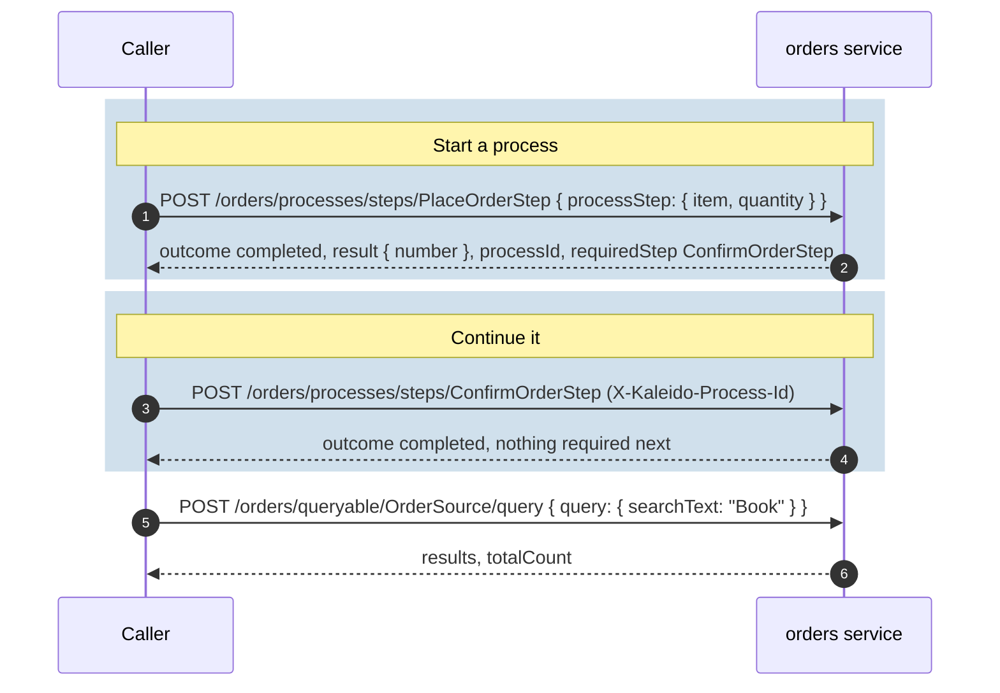

# Getting started

A small **orders** service from zero: a query source (what the service knows), two process steps
(what it can do), published over HTTP, then to AI agents over MCP. The code is the guide's compiled
example (`docs/guide/examples/GettingStarted`); a test runs it as shown here.

## 1. The data

In a real service this is your database; here, a list in memory:

<!-- snippet: getting-started-store -->
```csharp
// The orders themselves: in a real service, your database.
public sealed class OrderBook
{
    private readonly ConcurrentDictionary<int, OrderQueryContext> _orders = new();
    private int _lastNumber;

    public IEnumerable<OrderQueryContext> All => _orders.Values;

    public int Place(string item, int quantity)
    {
        var number = Interlocked.Increment(ref _lastNumber);
        _orders[number] = new OrderQueryContext { Number = number, Item = item, Quantity = quantity };
        return number;
    }
}
```

## 2. A query source

A **query context** describes what callers may ask: which fields they can filter, search and sort
by. The **source** returns an `IQueryable` of it; Kaleido applies the caller's filters, search, sort
and paging. Descriptions are published in the registry, which is what UIs and agents read (KAL2015).

<!-- snippet: getting-started-source -->
```csharp
// What can be asked about orders: the query context declares what is filterable, searchable and
// sortable; the source says where the data comes from.
public sealed record OrderQueryContext : IQueryContext
{
    [Description("The order number.")]
    [Filterable(FilterOperator.Equals)]
    [Sortable]
    public int Number { get; init; }

    [Description("What was ordered.")]
    [Searchable(Priority = 1, MatchMode = MatchMode.Contains)]
    public string Item { get; init; } = string.Empty;

    [Description("How many were ordered.")]
    public int Quantity { get; init; }
}

[QuerySource(
    Version = "1.0.0",
    DisplayName = "Orders",
    Description = "The orders placed in the shop.",
    DefaultSortField = nameof(OrderQueryContext.Number))]
[Pageable(DefaultSize = 20, MaxSize = 100)]
public sealed class OrderSource(OrderBook orders) : IQuerySource<OrderQueryContext>
{
    public IQueryable<OrderQueryContext> CreateQuery(QueryExecutionContext executionContext) =>
        orders.All.AsQueryable();
}
```

## 3. Two process steps

A **step** is a business action: a record of its inputs (validated with data annotations) and a
**handler** that does the work. The handler's result says what comes next: here, placing an order
requires the confirmation. `[DependsOn<PlaceOrderStep>]` makes confirming impossible before an order
exists. See [Processes](processes.md).

<!-- snippet: getting-started-steps -->
```csharp
// What can be done: placing an order starts a process; confirming it is the next step.
[ProcessStep(
    Version = "1.0.0",
    DisplayName = "Place order",
    Description = "Places an order for an item.")]
public sealed record PlaceOrderStep : IProcessStep
{
    [Required]
    [Description("What to order.")]
    public required string Item { get; init; }

    [Range(1, 10)]
    [Description("How many to order, from 1 to 10.")]
    public int Quantity { get; init; } = 1;
}

public sealed record PlacedOrder
{
    [Description("The number of the order placed.")]
    public int Number { get; init; }
}

public sealed class PlaceOrderHandler(OrderBook orders) : IProcessStepHandler<PlaceOrderStep, PlacedOrder>
{
    public Task<ProcessStepHandlerResult<PlacedOrder>> ExecuteAsync(
        PlaceOrderStep processStep,
        ProcessStepContext context,
        CancellationToken cancellationToken) =>
        Task.FromResult(
            ProcessStepHandlerResult
                .Success(new PlacedOrder { Number = orders.Place(processStep.Item, processStep.Quantity) })
                .Next<ConfirmOrderStep>());
}

[ProcessStep(
    Version = "1.0.0",
    DisplayName = "Confirm order",
    Description = "Confirms the order placed in this process.",
    RequiresConfirmation = true)]
[DependsOn<PlaceOrderStep>]
public sealed record ConfirmOrderStep : IProcessStep;

public sealed class ConfirmOrderHandler : IProcessStepHandler<ConfirmOrderStep>
{
    public Task<ProcessStepHandlerResult> ExecuteAsync(
        ConfirmOrderStep processStep,
        ProcessStepContext context,
        CancellationToken cancellationToken) =>
        Task.FromResult(ProcessStepHandlerResult.Success());
}
```

## 4. Publish it over HTTP

Register Kaleido with the assemblies to scan, then map the endpoints. Kaleido finds the source, the
steps and the handlers, and checks them at startup (a step without a handler, a broken relationship,
missing metadata all fail before the first request).

<!-- snippet: getting-started-host -->
```csharp
services.AddSingleton<OrderBook>();

services.AddKaleido(configuration, o =>
    {
        o.ServiceName = "orders";
        o.Assemblies = [typeof(OrderSource).Assembly];
        o.AuthorizationMode = KaleidoAuthorizationMode.None;   // local evaluation only
    })
    .AddHttp();
```

<!-- snippet: getting-started-map -->
```csharp
endpoints.MapKaleidoHttp();
```

> `AuthorizationMode.None` leaves every capability open, for local evaluation. The default is
> `Authenticated`; see [Callers and correlation](callers-and-correlation.md).

## 5. Call it



- **Place an order:** `POST /orders/processes/steps/PlaceOrderStep` with
  `{ "processStep": { "item": "Book", "quantity": 2 } }`. The answer carries the new `processId`, the
  handler's `result`, and `requiredStep`: the step to call next.
- **Continue the process:** `POST /orders/processes/steps/ConfirmOrderStep`, with the process id in
  the `X-Kaleido-Process-Id` header.
- **Query the orders:** `POST /orders/queryable/OrderSource/query` with
  `{ "query": { "searchText": "Book" } }`, or a `filter`, `sort` and `page`
  ([Queries](queries.md#the-query-a-caller-sends)).
- **Discover everything:** `GET /orders/registry` lists the steps, the source, their inputs and
  descriptions, and the URLs to call. Clients and the MCP adapter read it.

The routes, the body shapes and the error answers are in the
[`Kaleido.Http` README](../../src/Kaleido.Http/README.md).

## 6. Publish it to AI agents (MCP)

The MCP adapter turns the registry into tools and calls the service through a Kaleido client, as
the caller. Here the service publishes its own tools; a router can also publish several services
([README quick start](../../README.md#expose-configured-services-through-an-mcp-router)).

<!-- snippet: getting-started-mcp -->
```csharp
services.AddSingleton<OrderBook>();

services.AddKaleido(configuration, o =>
    {
        o.ServiceName = "orders";
        o.Assemblies = [typeof(OrderSource).Assembly];
        o.AuthorizationMode = KaleidoAuthorizationMode.None;   // local evaluation only
    })
    .AddHttp()
    .AddHttpClients()
    .AddMcp();
```

<!-- snippet: getting-started-mcp-map -->
```csharp
app.MapKaleidoHttp();
app.MapKaleidoMcp("/mcp");
```

The client the tools call through is configured like any Kaleido client:

```json
{ "Kaleido": { "Clients": { "orders": { "BaseUrl": "http://localhost:5100", "RoutePrefix": "orders" } } } }
```

An agent connected to `/mcp` sees one tool per capability, named `orders_<capability>` (the
service name, then the source or step; [naming](../../src/Kaleido.Http.Mcp/README.md#tools)). After
"Place order" it is told that "Confirm order" is next, and that it should ask the user to
confirm (`RequiresConfirmation`). See the [MCP adapter README](../../src/Kaleido.Http.Mcp/README.md).

## Next

- [Processes](processes.md): relationships, outcomes and what the caller is told.
- [Persistence](persistence.md): the default stores are in memory; choose real ones before production.
