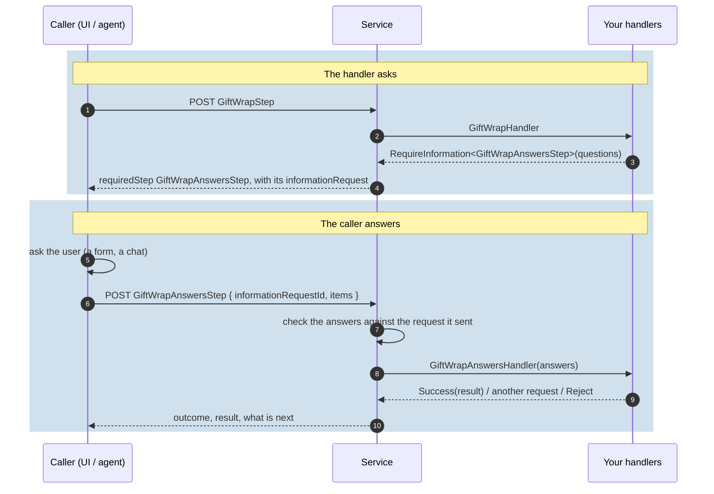

# Information requests

Some questions are only known at runtime: what to ask depends on your rules, your configuration, or
the answers so far. A handler can **ask** instead of returning a result: the process waits for the
answers, which come back through an **information step**. The example continues the orders service
(`docs/guide/examples/InformationRequests`); a test runs it.

## The round trip



<!-- snippet: information-ask -->
```csharp
// The questions are decided at runtime (here fixed, in a real service from your rules or
// configuration): the handler returns them instead of a result.
[ProcessStep(
    DisplayName = "Gift wrap",
    Description = "Asks whether and how the order should be gift wrapped.")]
[AvailableAfter<PlaceOrderStep>]
public sealed record GiftWrapStep : IProcessStep;

public sealed class GiftWrapHandler : IProcessStepHandler<GiftWrapStep>
{
    public Task<ProcessStepHandlerResult> ExecuteAsync(
        GiftWrapStep processStep,
        ProcessStepContext context,
        CancellationToken cancellationToken) =>
        Task.FromResult(ProcessStepHandlerResult.RequireInformation<GiftWrapAnswersStep>(new InformationRequest
        {
            InformationRequestId = "gift-wrap",
            Title = "Gift wrapping",
            Items =
            [
                new InformationItem
                {
                    Id = "wrap",
                    Text = "Should the order be gift wrapped?",
                    Type = InformationItemType.Boolean,
                },
                // Asked only when the first answer is yes.
                new InformationItem
                {
                    Id = "paper",
                    Text = "Which wrapping paper?",
                    Type = InformationItemType.Choice,
                    Options =
                    [
                        new InformationOption { Value = "red", Display = "Red" },
                        new InformationOption { Value = "gold", Display = "Gold" },
                    ],
                    EnableWhen = [new InformationCondition { Question = "wrap", Operator = InformationConditionOperator.Equals, Answer = "true" }],
                },
            ],
        }));
}
```

The answers come back as the information step's payload:

```json
{
  "processStep": {
    "informationRequestId": "gift-wrap",
    "items": [
      { "itemId": "wrap", "answers": [{ "value": "true" }] },
      { "itemId": "paper", "answers": [{ "value": "gold" }] }
    ]
  }
}
```

<!-- snippet: information-answer -->
```csharp
// The information step: its payload is the answers, nothing else.
[ProcessStep(
    DisplayName = "Gift wrap answers",
    Description = "The answers to the gift-wrapping questions.")]
public sealed record GiftWrapAnswersStep : IInformationStep
{
    public required string InformationRequestId { get; init; }

    public IReadOnlyList<InformationResponseItem> Items { get; init; } = [];
}

public sealed record GiftWrapChoice
{
    [Description("The wrapping paper chosen; empty when the order is not wrapped.")]
    public string? Paper { get; init; }
}

public sealed class GiftWrapAnswersHandler : IProcessStepHandler<GiftWrapAnswersStep, GiftWrapChoice>
{
    public Task<ProcessStepHandlerResult<GiftWrapChoice>> ExecuteAsync(
        GiftWrapAnswersStep processStep,
        ProcessStepContext context,
        CancellationToken cancellationToken)
    {
        // Kaleido checked the answers against the request it sent; what they mean is yours.
        var paper = processStep.Items.SingleOrDefault(x => x.ItemId == "paper")?.Answers is [var answer, ..] ? answer.Value : null;

        return Task.FromResult(ProcessStepHandlerResult.Success(new GiftWrapChoice { Paper = paper }));
    }
}
```

- Kaleido owns the questions' **shape** (types, options, required, conditions) and checks the answers
  against the request it sent before your handler runs. **What** to ask and what the answers mean
  are yours.
- To ask again (rounds), make the information step `[Repeatable]` and have its handler require
  itself with the next request.

## Conditional questions

`EnableWhen` shows a question only when an earlier answer matches (the FHIR operator set: `Exists`,
`Equals`, `NotEquals`, `GreaterThan`, ...). Kaleido evaluates the conditions
([ADR 0024](../decisions/0024-conditional-questions.md)):

| The caller sends | Result |
|---|---|
| `wrap = true`, `paper = gold` | accepted; the handler sees both |
| `wrap = false` (no paper) | accepted: the paper question is not enabled, so it needs no answer |
| `wrap = false`, `paper = red` | **not accepted**: the outcome is `pending`, the same request is asked again, and the handler never sees the answer to a question that was not enabled |

The MCP adapter asks in rounds: forms where the client supports them, a chat conversation otherwise.

## Where to read more

- The contracts, validation, state and events: [INFORMATION_REQUESTS](../INFORMATION_REQUESTS.md).
- The handler shape: [PATTERNS - Information step](../PATTERNS.md#information-step-runtime-decided-questions).
- A complete example: the PriorAuth radiology questionnaire ([PriorAuth sample](https://github.com/no1ross/Kaleido-Samples-PriorAuth), in its own repository).
