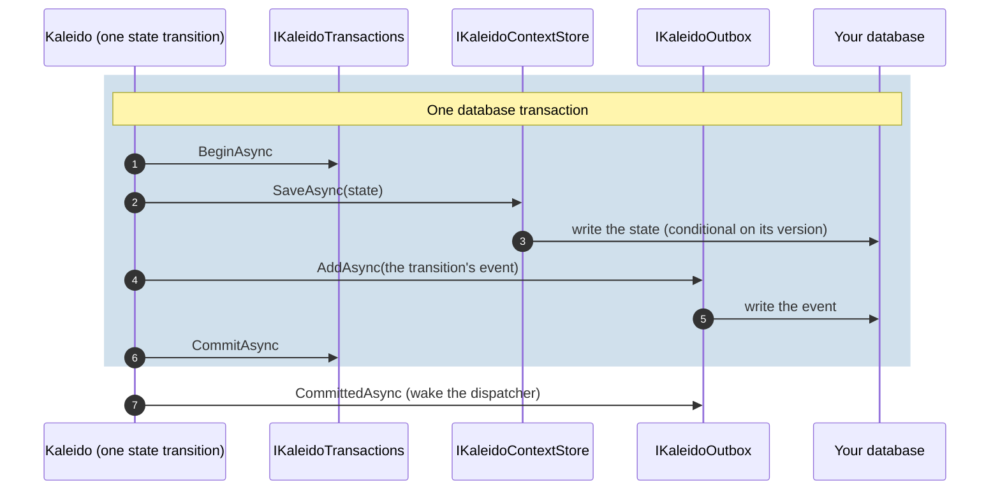

# Persistence

Kaleido stores three things, each behind its own contract (`Kaleido.Storage`,
[ADR 0020](../decisions/0020-three-store-contracts.md), [ADR 0023](../decisions/0023-outbox-integration.md)):

| Contract | Holds | Needed when |
|---|---|---|
| `IKaleidoContextStore` | the state of each process (one row per process, saved conditionally on its version) | the service has steps |
| the outbox: `IKaleidoOutbox`, or `IKaleidoOutboxStore` for Kaleido's built-in outbox | events waiting to be delivered ([Events and the outbox](events-and-outbox.md)) | events are published |
| `IKaleidoIdempotencyStore` | the answers to requests sent with an `Idempotency-Key`, for replays | callers retry (the Kaleido clients always send a key) |

Optional: `IKaleidoTransactions`, one transaction around a state change and its event.

## The defaults are in memory

Without registrations, all three are in memory, and each logs a warning at startup: state, events
waiting to be published and idempotency records are **lost on restart**, and every instance sees
only its own. Fine for tests and local evaluation; choose real stores before production.

## Three ways to persist

| Choice | Registration | For |
|---|---|---|
| SQLite reference provider | `AddSqliteContextStore`, `AddSqliteOutboxStore`, `AddSqliteIdempotencyStore` (one database) | samples, local development, a reference to copy ([README](../../src/Kaleido.Provider.SQLite/README.md)) |
| Your own stores | `AddContextStore<T>()`, `AddOutboxStore<T>()` or `AddOutbox<T>()`, `AddIdempotencyStore<T>()`, `AddTransactions<T>()` | production, on your database |
| In memory (default) | nothing | tests, local evaluation |

The SQLite provider does not create its schema: the host does, once at startup
(`EnsureCreatedAsync`, shown in the provider README), and it never migrates an existing database.

## Atomicity: one database, one transaction

When a step completes, Kaleido saves the process state and writes the transition's event
(`ProcessCreated`, `StepCompleted`) in **one sequence**: begin, save the state, add the event,
commit, then tell the outbox it committed. A failure before the commit keeps **neither**.



This holds **only when the context store and the outbox write to the database the transaction
covers**: one EF Core `DbContext`, a MongoDB session, or a provider's transaction your outbox joins.
Across two databases each write stands alone; Kaleido never attempts a distributed transaction.
Events that are not part of a state transition (a plan built, a query executed, a failure) are
written without a transaction, and a failure to write them never fails the request.

## Your own stores on EF Core

A complete example on one `DbContext` (compiled, and tested: a conflicting save keeps neither the
state nor its event). Use your own schema, serialization and migrations; the parts that matter are
the shared, scoped `DbContext` and the conditional save.

<!-- snippet: persistence-dbcontext -->
```csharp
// One DbContext for the process state and the outbox: registered scoped, one per request, so the
// context store, the outbox and the transaction share it.
public sealed class OrdersDbContext(DbContextOptions<OrdersDbContext> options) : DbContext(options)
{
    public DbSet<ProcessRow> Processes => Set<ProcessRow>();

    public DbSet<OutboxMessage> OutboxMessages => Set<OutboxMessage>();

    protected override void OnModelCreating(ModelBuilder modelBuilder)
    {
        modelBuilder.Entity<ProcessRow>().HasKey(x => x.ProcessId);
        modelBuilder.Entity<OutboxMessage>().HasKey(x => x.EventId);
    }
}

public sealed class ProcessRow
{
    public Guid ProcessId { get; set; }

    public long Version { get; set; }

    public string State { get; set; } = string.Empty;
}

public sealed class OutboxMessage
{
    public Guid EventId { get; set; }

    public string EventType { get; set; } = string.Empty;

    public string Payload { get; set; } = string.Empty;

    public DateTimeOffset OccurredUtc { get; set; }
}
```

The context store saves the state **conditionally on its version**: a stale save throws
`KaleidoConcurrencyException`, which callers receive as 409 `pro_process_conflict`. Never overwrite.

<!-- snippet: persistence-context-store -->
```csharp
// Process state only, saved conditionally: a stale version is a conflict (409), never an overwrite.
public sealed class OrdersContextStore(OrdersDbContext db) : IKaleidoContextStore
{
    public async Task<ProcessorContext?> LoadAsync(Guid processId, CancellationToken cancellationToken) =>
        await db.Processes.AsNoTracking().SingleOrDefaultAsync(x => x.ProcessId == processId, cancellationToken) is { } row
            ? JsonSerializer.Deserialize<ProcessorContext>(row.State)
            : null;

    public async Task<ProcessorContext> SaveAsync(ProcessorContext context, CancellationToken cancellationToken)
    {
        var saved = context with { Version = context.Version + 1 };
        var state = JsonSerializer.Serialize(saved);

        if (context.Version == 0)
        {
            if (await db.Processes.AnyAsync(x => x.ProcessId == context.ProcessId, cancellationToken))
            {
                throw new KaleidoConcurrencyException(context.ProcessId);
            }

            db.Processes.Add(new ProcessRow { ProcessId = context.ProcessId, Version = saved.Version, State = state });
            await db.SaveChangesAsync(cancellationToken);
            return saved;
        }

        var updated = await db.Processes
            .Where(x => x.ProcessId == context.ProcessId && x.Version == context.Version)
            .ExecuteUpdateAsync(x => x.SetProperty(p => p.Version, saved.Version).SetProperty(p => p.State, state), cancellationToken);

        return updated == 1 ? saved : throw new KaleidoConcurrencyException(context.ProcessId);
    }
}
```

<!-- snippet: persistence-outbox -->
```csharp
// Your outbox: Kaleido hands it every event; a state transition's event inside the transaction.
public sealed class OrdersOutbox(OrdersDbContext db) : IKaleidoOutbox
{
    public async Task AddAsync(IReadOnlyCollection<KaleidoOutboxEvent> events, CancellationToken cancellationToken)
    {
        db.OutboxMessages.AddRange(events.Select(x => new OutboxMessage
        {
            EventId = x.EventId,
            EventType = x.EventType,
            Payload = x.Payload,
            OccurredUtc = x.OccurredUtc,
        }));

        await db.SaveChangesAsync(cancellationToken);
    }

    // Optional: after the commit, wake your dispatcher instead of waiting for its next poll.
    public Task CommittedAsync(CancellationToken cancellationToken) => Task.CompletedTask;
}
```

<!-- snippet: persistence-transactions -->
```csharp
// One database transaction per state transition, on the shared DbContext: the state and its event
// commit together, or neither is kept.
public sealed class OrdersTransactions(OrdersDbContext db) : IKaleidoTransactions
{
    public async Task<IKaleidoTransaction> BeginAsync(CancellationToken cancellationToken) =>
        new Transaction(await db.Database.BeginTransactionAsync(cancellationToken));

    private sealed class Transaction(IDbContextTransaction transaction) : IKaleidoTransaction
    {
        public Task CommitAsync(CancellationToken cancellationToken) => transaction.CommitAsync(cancellationToken);

        public ValueTask DisposeAsync() => transaction.DisposeAsync();   // without a commit: rolled back
    }
}
```

<!-- snippet: persistence-registration -->
```csharp
services.AddDbContext<OrdersDbContext>(o => o.UseSqlite(connectionString));   // scoped

return services.AddKaleido(configuration, o =>
    {
        o.ServiceName = "orders";
        o.Assemblies = [typeof(OrdersContextStore).Assembly];
    })
    .AddContextStore<OrdersContextStore>()
    .AddOutbox<OrdersOutbox>()
    .AddTransactions<OrdersTransactions>()
    // This example keeps its idempotency records in memory; a production host registers a
    // durable IKaleidoIdempotencyStore (AddIdempotencyStore<T>(), AddSqliteIdempotencyStore).
    .AddInMemoryStores();
```

Every store a service uses is chosen at registration: a durable one, or memory explicitly with
`AddInMemoryStores()`. A service with process steps uses the context and idempotency stores; one that
publishes events through Kaleido's built-in outbox also uses an outbox store (your own outbox and
direct publication need none). A store left at its in-memory default stops the host at startup with
`stores_not_chosen`, naming the store ([ADR 0028](../decisions/0028-stores-are-chosen-explicitly.md)).

With your own outbox, Kaleido's outbox store and relay are not used: your dispatcher delivers the
events (it needs no `IEventPublisher`). To use **Kaleido's** outbox on your database instead,
implement `IKaleidoOutboxStore` (claims with leases, retries, parking) and register it with
`AddOutboxStore<T>()`; the SQLite provider's store is the reference.

## Which store for which concern

- **One store per contract** per service: two implementations fail at startup
  (`conflicting_store`), as do two outbox choices (`conflicting_outbox`).
- **Idempotency records** can live elsewhere (a cache with expiry is fine): they are not part of the
  transaction.
- **Several instances** share the stores: the conditional save is what makes concurrent calls for
  one process safe ([Deployment](deployment.md)).
