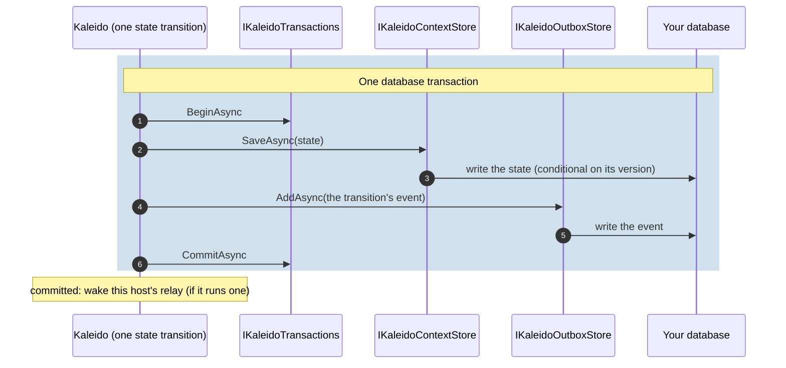

# Persistence

Kaleido stores three things, each behind its own contract (`Kaleido.Storage`,
[ADR 0020](../decisions/0020-three-store-contracts.md), [ADR 0023](../decisions/0023-outbox-integration.md)):

| Contract | Holds | Needed when |
|---|---|---|
| `IKaleidoContextStore` | the state of each process (one row per process, saved conditionally on its version) | the service has steps |
| `IKaleidoOutboxStore` | every event the service writes, until the relay publishes it ([Events and the outbox](events-and-outbox.md)) | always: every service writes its events |
| `IKaleidoIdempotencyStore` | the answers to requests sent with an `Idempotency-Key`, for replays | callers retry (the Kaleido clients always send a key) |

Optional: `IKaleidoTransactions`, one transaction around a state change and its event.

## The defaults are in memory

Without registrations, all three are in memory, and each logs a warning at startup: state, events
waiting to be published and idempotency records are **lost on restart**, and every instance sees
only its own. Fine for tests and local evaluation; choose real stores before production.

## Three ways to persist

| Choice | Registration | For |
|---|---|---|
| SQLite reference provider | `AddSqliteContextStore`, `AddSqliteOutboxStore`, `AddSqliteIdempotencyStore` (one database) | samples, local development, a reference to copy ([README](../../src/Providers/Provider.SQLite/README.md)) |
| Your own stores | `AddContextStore<T>()`, `AddOutboxStore<T>()`, `AddIdempotencyStore<T>()`, `AddTransactions<T>()` | production, on your database |
| In memory (default) | nothing | tests, local evaluation |

The SQLite provider does not create its schema: the host does, once at startup
(`EnsureCreatedAsync`, shown in the provider README), and it never migrates an existing database.

## Atomicity: one database, one transaction

When a step completes, Kaleido saves the process state and writes the transition's event
(`ProcessCreated`, `StepCompleted`) in **one sequence**: begin, save the state, add the event,
commit, then wake the relay if this host runs it. A failure before the commit keeps **neither**.



This holds **only when the context store and the outbox write to the database the transaction
covers**: one EF Core `DbContext`, a MongoDB session, or a provider's transaction your outbox store joins.
Across two databases each write stands alone; Kaleido never attempts a distributed transaction.
Events that are not part of a state transition (a plan built, a query executed, a failure) are
written without a transaction, and a failure to write them never fails the request.

## Your own stores on EF Core

A complete example on one `DbContext` (compiled, and tested: a conflicting save keeps neither the
state nor its event). Use your own schema, serialization and migrations; the parts that matter are
the shared, scoped `DbContext` and the conditional save.

<!-- snippet: persistence-dbcontext -->
```csharp
// One DbContext for the process state and the outbox: registered scoped, one per request, so the
// context store, the outbox store and the transaction share it.
public sealed class OrdersDbContext(DbContextOptions<OrdersDbContext> options) : DbContext(options)
{
    public DbSet<ProcessRow> Processes => Set<ProcessRow>();

    public DbSet<OutboxMessage> OutboxMessages => Set<OutboxMessage>();

    public DbSet<OutboxRelayRow> OutboxRelays => Set<OutboxRelayRow>();

    protected override void OnModelCreating(ModelBuilder modelBuilder)
    {
        // A process is stored under its processor, version and id: services and versions may share it.
        modelBuilder.Entity<ProcessRow>().HasKey(x => new { x.ProcessorName, x.ProcessorVersion, x.ProcessId });
        modelBuilder.Entity<OutboxMessage>().HasKey(x => x.EventId);
        modelBuilder.Entity<OutboxRelayRow>().HasKey(x => x.InstanceId);
    }
}

public sealed class ProcessRow
{
    public string ProcessorName { get; set; } = string.Empty;

    // Empty when the processor is unversioned: a key column is never null.
    public string ProcessorVersion { get; set; } = string.Empty;

    public Guid ProcessId { get; set; }

    public long Version { get; set; }

    public string State { get; set; } = string.Empty;
}

// Times as UTC ticks, so due and expired entries are found with plain comparisons.
public sealed class OutboxMessage
{
    public Guid EventId { get; set; }

    public string EventType { get; set; } = string.Empty;

    public string ServiceName { get; set; } = string.Empty;

    public string? ServiceVersion { get; set; }

    public string Payload { get; set; } = string.Empty;

    public long OccurredUtc { get; set; }

    public int Attempts { get; set; }

    public long NextAttemptUtc { get; set; }

    public string? LastError { get; set; }

    public bool IsParked { get; set; }

    public string? LeaseOwner { get; set; }

    public long LeaseUntil { get; set; }
}

// A relay instance's heartbeat: the writers' health check reads it to know a relay drains the outbox.
public sealed class OutboxRelayRow
{
    public Guid InstanceId { get; set; }

    public string ServiceName { get; set; } = string.Empty;

    public string Publisher { get; set; } = string.Empty;

    public long SeenUtc { get; set; }
}
```

The context store saves the state **conditionally on its version**: a stale save throws
`KaleidoConcurrencyException`, which callers receive as 409 `pro_process_conflict`. Never overwrite.

<!-- snippet: persistence-context-store -->
```csharp
// Process state only, saved conditionally: a stale version is a conflict (409), never an overwrite.
// Every query matches the whole key - processor, version and id - so another service's or version's
// process under the same id (a hand-off) is never read or overwritten.
public sealed class OrdersContextStore(OrdersDbContext db) : IKaleidoContextStore
{
    public async Task<ProcessorContext?> LoadAsync(ProcessKey key, CancellationToken cancellationToken) =>
        await ByKey(db.Processes.AsNoTracking(), key).SingleOrDefaultAsync(cancellationToken) is { } row
            ? JsonSerializer.Deserialize<ProcessorContext>(row.State)
            : null;

    public async Task<ProcessorContext> SaveAsync(ProcessorContext context, CancellationToken cancellationToken)
    {
        var saved = context with { Version = context.Version + 1 };
        var state = JsonSerializer.Serialize(saved);

        if (context.Version == 0)
        {
            if (await ByKey(db.Processes, context.Key).AnyAsync(cancellationToken))
            {
                throw new KaleidoConcurrencyException(context.ProcessId);
            }

            db.Processes.Add(new ProcessRow
            {
                ProcessorName = context.ProcessorName,
                ProcessorVersion = context.ProcessorVersion ?? string.Empty,
                ProcessId = context.ProcessId,
                Version = saved.Version,
                State = state,
            });
            await db.SaveChangesAsync(cancellationToken);
            return saved;
        }

        var updated = await ByKey(db.Processes, context.Key)
            .Where(x => x.Version == context.Version)
            .ExecuteUpdateAsync(x => x.SetProperty(p => p.Version, saved.Version).SetProperty(p => p.State, state), cancellationToken);

        return updated == 1 ? saved : throw new KaleidoConcurrencyException(context.ProcessId);
    }

    private static IQueryable<ProcessRow> ByKey(IQueryable<ProcessRow> rows, ProcessKey key)
    {
        var version = key.ProcessorVersion ?? string.Empty;

        return rows.Where(x => x.ProcessorName == key.ProcessorName && x.ProcessorVersion == version && x.ProcessId == key.ProcessId);
    }
}
```

<!-- snippet: persistence-outbox -->
```csharp
// The outbox on the same DbContext: every event the service writes - a state transition's inside its
// transaction - and the relay's claims, each leased to one relay instance at a time.
public sealed class OrdersOutboxStore(OrdersDbContext db, KaleidoServiceOptions service, TimeProvider time) : IKaleidoOutboxStore
{
    private string Owner => service.InstanceId.ToString("N");

    public async Task AddAsync(IReadOnlyCollection<KaleidoOutboxEvent> events, CancellationToken cancellationToken)
    {
        db.OutboxMessages.AddRange(events.Select(x => new OutboxMessage
        {
            EventId = x.EventId,
            EventType = x.EventType,
            ServiceName = x.ServiceName,
            ServiceVersion = x.ServiceVersion,
            Payload = x.Payload,
            OccurredUtc = x.OccurredUtc.UtcTicks,
            NextAttemptUtc = x.NextAttemptUtc.UtcTicks,
        }));

        await db.SaveChangesAsync(cancellationToken);
    }

    // A compare-and-set: the UPDATE re-checks that each entry is still unleased, so two relays claiming
    // at once never get the same one; each reads back only what it leased.
    public async Task<IReadOnlyList<KaleidoOutboxEvent>> ClaimEventsAsync(int maxCount, TimeSpan lease, CancellationToken cancellationToken)
    {
        var now = time.GetUtcNow().UtcTicks;
        var until = now + lease.Ticks;
        var due = await db.OutboxMessages.AsNoTracking()
            .Where(x => !x.IsParked && x.NextAttemptUtc <= now && x.LeaseUntil <= now)
            .OrderBy(x => x.OccurredUtc).Select(x => x.EventId).Take(maxCount)
            .ToListAsync(cancellationToken);

        await db.OutboxMessages
            .Where(x => due.Contains(x.EventId) && !x.IsParked && x.LeaseUntil <= now)
            .ExecuteUpdateAsync(x => x.SetProperty(m => m.LeaseOwner, Owner).SetProperty(m => m.LeaseUntil, until), cancellationToken);

        var claimed = await db.OutboxMessages.AsNoTracking()
            .Where(x => due.Contains(x.EventId) && x.LeaseOwner == Owner && x.LeaseUntil == until)
            .OrderBy(x => x.OccurredUtc)
            .ToListAsync(cancellationToken);

        return [.. claimed.Select(x => new KaleidoOutboxEvent
        {
            EventId = x.EventId,
            EventType = x.EventType,
            ServiceName = x.ServiceName,
            ServiceVersion = x.ServiceVersion,
            Payload = x.Payload,
            OccurredUtc = new DateTimeOffset(x.OccurredUtc, TimeSpan.Zero),
            Attempts = x.Attempts,
            NextAttemptUtc = new DateTimeOffset(x.NextAttemptUtc, TimeSpan.Zero),
            LastError = x.LastError,
        })];
    }

    // Both only while this instance still holds the lease.
    public Task CompleteEventAsync(Guid eventId, CancellationToken cancellationToken) =>
        Leased(eventId).ExecuteDeleteAsync(cancellationToken);

    public Task FailEventAsync(Guid eventId, DateTimeOffset? retryAtUtc, string errorMessage, CancellationToken cancellationToken) =>
        Leased(eventId).ExecuteUpdateAsync(
            x => x.SetProperty(m => m.Attempts, m => m.Attempts + 1)
                .SetProperty(m => m.LastError, errorMessage)
                .SetProperty(m => m.NextAttemptUtc, (retryAtUtc ?? time.GetUtcNow()).UtcTicks)
                .SetProperty(m => m.IsParked, retryAtUtc == null)
                .SetProperty(m => m.LeaseOwner, (string?)null)
                .SetProperty(m => m.LeaseUntil, 0L),
            cancellationToken);

    // The relay's heartbeat, one row per relay instance.
    public async Task RecordRelayAsync(KaleidoOutboxRelay relay, CancellationToken cancellationToken)
    {
        var row = await db.OutboxRelays.FindAsync([relay.InstanceId], cancellationToken);

        if (row is null)
        {
            db.OutboxRelays.Add(row = new OutboxRelayRow { InstanceId = relay.InstanceId });
        }

        (row.ServiceName, row.Publisher, row.SeenUtc) = (relay.ServiceName, relay.Publisher, relay.SeenUtc.UtcTicks);
        await db.SaveChangesAsync(cancellationToken);
    }

    // What the outbox health check reads: the last heartbeat and the due entries.
    public async Task<KaleidoOutboxStatus> GetStatusAsync(DateTimeOffset now, CancellationToken cancellationToken)
    {
        var due = db.OutboxMessages.AsNoTracking().Where(x => !x.IsParked && x.NextAttemptUtc <= now.UtcTicks);
        var seen = await db.OutboxRelays.AsNoTracking().MaxAsync(x => (long?)x.SeenUtc, cancellationToken);
        var oldest = await due.MinAsync(x => (long?)x.OccurredUtc, cancellationToken);

        return new KaleidoOutboxStatus
        {
            LastRelaySeenUtc = seen is { } ticks ? new DateTimeOffset(ticks, TimeSpan.Zero) : null,
            DueCount = await due.LongCountAsync(cancellationToken),
            OldestDueUtc = oldest is { } occurred ? new DateTimeOffset(occurred, TimeSpan.Zero) : null,
        };
    }

    private IQueryable<OutboxMessage> Leased(Guid eventId)
    {
        var now = time.GetUtcNow().UtcTicks;

        return db.OutboxMessages.Where(x => x.EventId == eventId && x.LeaseOwner == Owner && x.LeaseUntil > now);
    }
}
```

<!-- snippet: persistence-transactions -->
```csharp
// One database transaction per state transition, on the shared DbContext: the state and its event
// commit together, or neither is kept.
public sealed class OrdersTransactions(OrdersDbContext db) : IKaleidoTransactions
{
    public async Task<IKaleidoTransaction> BeginAsync(CancellationToken cancellationToken) =>
        new Transaction(await db.Database.BeginTransactionAsync(cancellationToken));

    private sealed class Transaction(IDbContextTransaction transaction) : IKaleidoTransaction
    {
        public Task CommitAsync(CancellationToken cancellationToken) => transaction.CommitAsync(cancellationToken);

        public ValueTask DisposeAsync() => transaction.DisposeAsync();   // without a commit: rolled back
    }
}
```

<!-- snippet: persistence-registration -->
```csharp
services.AddDbContext<OrdersDbContext>(o => o.UseSqlite(connectionString));   // scoped

return services.AddKaleido(configuration, new() { ServiceName = "orders", Assemblies = [typeof(OrdersContextStore).Assembly] })
    .AddContextStore<OrdersContextStore>()
    .AddOutboxStore<OrdersOutboxStore>()
    .AddTransactions<OrdersTransactions>()
    // This example keeps its idempotency records in memory; a production host registers a
    // durable IKaleidoIdempotencyStore (AddIdempotencyStore<T>(), AddSqliteIdempotencyStore).
    .AddInMemoryStores();
```

Every store a service uses is chosen at registration: a durable one, or memory explicitly with
`AddInMemoryStores()`. A service with process steps uses the context and idempotency stores, and every
service uses an outbox store, since every service writes its events. A store left at its in-memory
default stops the host at startup with `stores_not_chosen`, naming the store
([ADR 0028](../decisions/0028-stores-are-chosen-explicitly.md), [ADR 0036](../decisions/0036-stores-scoped-by-service-and-a-shared-outbox-relay.md)).

The outbox store above also serves the relay (`AddOutboxRelay<TPublisher>()`, on this service or on
another host reading the same database): its claims are leased compare-and-sets, so several relay
instances never publish one entry twice. The SQLite provider's store is the reference.

**Several services on one database.** Every record is scoped by the service and its version: the
context store's key is `ProcessKey` (processor, version, process id), and every query must match all
three, so services and versions may share the database. A document store (MongoDB) keys a process by
the three, for example a compound `_id`.

## Which store for which concern

- **One store per contract** per service: two implementations fail at startup
  (`conflicting_store`), as do two outbox stores or two relays with different publishers
  (`conflicting_outbox`).
- **Idempotency records** can live elsewhere (a cache with expiry is fine): they are not part of the
  transaction.
- **Several instances** share the stores: the conditional save is what makes concurrent calls for
  one process safe ([Deployment](deployment.md)).
