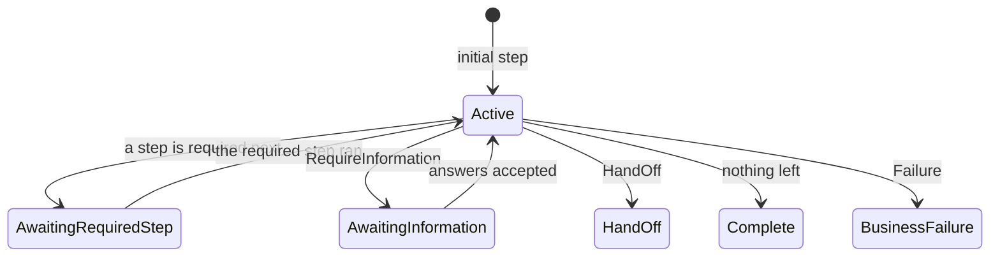

# Processes

A **processor** is a service's set of steps; a **process** is one running instance, identified by
its `processId`. Each step call runs the step's handler and answers with what the caller may or must
do next, so the caller follows the process instead of hard-coding it. The examples continue the
[getting-started](getting-started.md) orders service (`docs/guide/examples/Processes`); a test runs
each behavior described here.

## Steps and handlers

- A step is an `IProcessStep` record: its type name is its name everywhere (registry, wire, state,
  events). `[ProcessStep]` describes it (`DisplayName`, `Description`, required).
- Its inputs are the record's properties, validated with data annotations; required value types use
  the C# `required` keyword (KAL2018).
- Exactly one handler per step: `IProcessStepHandler<TStep>`, or `IProcessStepHandler<TStep, TResult>`
  to return a result (described for agents, KAL2021).
- Every rule: [PATTERNS - Step + handler](../PATTERNS.md#step--handler).

## What happens on a call

```mermaid
sequenceDiagram
    autonumber
    participant C as Caller
    participant R as Kaleido Process runtime
    participant H as Your handler
    participant S as Context store

    rect rgba(70, 130, 180, 0.25)
        Note over C,S: One step call
        C->>R: POST /{service}/processes/steps/{Step} (+ X-Kaleido-Process-Id)
        R->>S: load the process (or start one, for an initial step)
        R->>R: validate the inputs; check the step may run now
        R->>H: ExecuteAsync(step, context)
        H-->>R: Success / Next / Reject / Failure / RequireInformation / HandOff
        R->>S: save the new state (conditional on its version)
        R-->>C: status, result, requiredStep, availableSteps, messages
    end
```

## Which steps may run

Relationships are declared on the step, typed, and checked at startup:

| Declaration | Meaning |
|---|---|
| (none) | An **initial** step: available when a process starts |
| `[DependsOn<T>]` | Runs only after `T` completed (in the history or earlier in the same call) |
| `[AvailableAfter<T>]` | Becomes available once `T` completed, and stays available |
| `[AvailableUntil<T>]` | Stops being available once `T` completed |
| `[Repeatable]` | May run again; without it a completed step is not offered again |

<!-- snippet: processes-relationships -->
```csharp
// A note can be added any time after the order is placed, as often as needed.
[ProcessStep(
    DisplayName = "Add note",
    Description = "Adds a note to the order.")]
[AvailableAfter<PlaceOrderStep>]
[Repeatable]
public sealed record AddNoteStep : IProcessStep
{
    [Required]
    [Description("The note.")]
    public required string Text { get; init; }
}

// The order can be cancelled once it is placed, until it ships.
[ProcessStep(
    DisplayName = "Cancel order",
    Description = "Cancels the order before it ships.",
    Destructive = true,
    RequiresConfirmation = true)]
[AvailableAfter<PlaceOrderStep>]
[AvailableUntil<ShipOrderStep>]
public sealed record CancelOrderStep : IProcessStep;

// Shipping needs the confirmation first, and is no longer possible once the order is cancelled.
[ProcessStep(
    DisplayName = "Ship order",
    Description = "Hands the confirmed order to a carrier.",
    External = true)]
[DependsOn<ConfirmOrderStep>]
[AvailableUntil<CancelOrderStep>]
public sealed record ShipOrderStep : IProcessStep
{
    [Required]
    [Description("The carrier: post or courier.")]
    public required string Carrier { get; init; }

    [Required]
    [Pii]
    [Description("The delivery address.")]
    public required string Address { get; init; }
}
```

A handler can name the **required** next step (`Success<TNext>()`, or `Success(result).Next<TNext>()`;
"Place order" requires "Confirm order"). While a step is required, **only it runs**: calling another
step is answered with status `pending` and the required step again (not an error, nothing runs).
When nothing is required, the caller chooses among the **available** steps.

| After | Available | Not available |
|---|---|---|
| Confirm order | Ship order, Cancel order, Add note | Confirm order (not repeatable) |
| Ship order | Return order, Add note | Cancel order (`AvailableUntil<ShipOrderStep>`) |
| Cancel order | Add note | Ship order (`AvailableUntil<CancelOrderStep>`) |

## Outcomes

<!-- snippet: processes-outcomes -->
```csharp
public sealed class ShipOrderHandler : IProcessStepHandler<ShipOrderStep>
{
    public Task<ProcessStepHandlerResult> ExecuteAsync(
        ShipOrderStep processStep,
        ProcessStepContext context,
        CancellationToken cancellationToken)
    {
        // Cannot proceed: the process ends.
        if (processStep.Address.Contains("Antarctica", StringComparison.OrdinalIgnoreCase))
        {
            return Task.FromResult(ProcessStepHandlerResult.Failure(new ProcessMessage
            {
                Code = "no_delivery",
                Type = MessageType.Error,
                Message = "We do not deliver to Antarctica.",
            }));
        }

        // The caller can correct this or try again later: the step is not completed and the process
        // is left exactly as it was.
        if (processStep.Carrier == "courier")
        {
            return Task.FromResult(ProcessStepHandlerResult.Reject(new ProcessMessage
            {
                Code = "carrier_closed",
                Type = MessageType.Warning,
                Message = "The courier is not collecting today. Choose the post, or try again tomorrow.",
            }));
        }

        return Task.FromResult(ProcessStepHandlerResult.Success());
    }
}
```

| Handler returns | Answer's `status` | The process |
|---|---|---|
| `Success()`, `Success<TNext>()`, `Success(result).Next<TNext>()` | `completed` | moves on; `requiredStep` / `availableSteps` say what is next |
| `RequireInformation<TNext>(request)` | `completed` | waits for answers ([Information requests](information-requests.md)) |
| `HandOff(processor)` | `completed` | continues on another processor (`targetProcessorName`) |
| `Reject(messages)` | `rejected` | **unchanged**: the caller corrects the input or retries ([ADR 0008](../decisions/0008-rejected-outcome-and-retryable-exceptions.md)) |
| `Failure(messages)` | `failed` | ends: its state is `businessFailure` |
| an unexpected exception, or a result that breaks a process rule | `exception` | unchanged, so the step can be retried once the defect is fixed |
| input that fails its validation rules | `validationFailed` | unchanged: the caller corrects the input |
| the caller cancels while the handler runs | `canceled` | unchanged: the step can be sent again |

The messages are your words for the user (`businessMessages` in the answer), kept apart from Kaleido's
diagnostics (`frameworkMessages`). The process state is read with `GET /{service}/processes/{processId}`;
enum values are camelCase on the wire (`businessFailure`, `awaitingRequiredStep`).



## Across processors

<!-- snippet: processes-handoff -->
```csharp
// Returns are another service's business: the process continues there.
[ProcessStep(
    DisplayName = "Return order",
    Description = "Starts a return of the shipped order; the returns service continues the process.")]
[AvailableAfter<ShipOrderStep>]
public sealed record ReturnOrderStep : IProcessStep;

// HandOff only tells the caller where the process continues; the handler starts it there. Called
// from this step, the returns service starts its process under this process's id (a handoff).
public sealed class ReturnOrderHandler(IKaleidoProcessorClientFactory processors) : IProcessStepHandler<ReturnOrderStep>
{
    public async Task<ProcessStepHandlerResult> ExecuteAsync(
        ReturnOrderStep processStep,
        ProcessStepContext context,
        CancellationToken cancellationToken)
    {
        await processors.GetClient("returns").ExecuteStepAsync(new OpenReturnStep(), cancellationToken);

        return ProcessStepHandlerResult.HandOff("returns");
    }
}

// The returns service's step, mirrored by its name: not an IProcessStep here, it is not this service's.
public sealed record OpenReturnStep;
```

`HandOff` is a signal, not a call: it names the processor that continues
(`targetProcessorName: "returns"`), and nothing is sent to it. The handler starts the process there
itself, with a Kaleido client (`AddHttpClients()` and a `returns` client under `Kaleido:Clients`).
The client sends this process's id and the calling processor, so the returns service starts its
process under the **same id**, which an unknown id only does for such a call from another
processor's step ([ADR 0009](../decisions/0009-unknown-process-id-only-on-handoff.md)). The caller
then continues there with that `processId`. Each processor keeps its own state
([Callers and correlation](callers-and-correlation.md)).

## Concurrent and repeated calls

- **Two calls for one process at once:** the state is saved conditionally on its version; the second
  gets **409** `pro_process_conflict`, and its handler's work must be safe to run again. See
  [PATTERNS - Concurrency](../PATTERNS.md#concurrency-idempotency-and-retries).
- **A retried call:** send an `Idempotency-Key` (the Kaleido clients always do); a repeat is answered
  from the stored result instead of running the step again
  ([ADR 0019](../decisions/0019-idempotent-execution-admission.md)).

## Changing a step later

A step has no version: its name is its identity, one definition per name is live, and running
processes continue on the deployed definition (completed steps stay in their history). A breaking
change takes a new step name. See
[PATTERNS - Changing a step, source or view](../PATTERNS.md#changing-a-step-source-or-view) and
[ADR 0029](../decisions/0029-capabilities-have-no-version.md).
