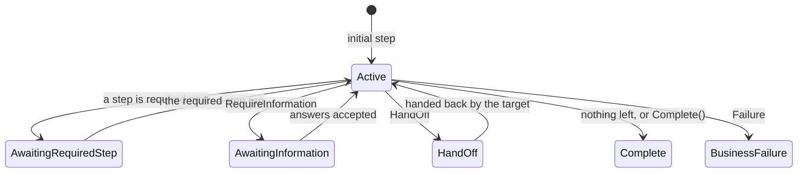

# Processes

A **processor** is a service's set of steps; a **process** is one running instance, identified by
its `processId`. Each step call runs the step's handler and answers with what the caller may or must
do next, so the caller follows the process instead of hard-coding it. The examples continue the
[getting-started](getting-started.md) orders service (`docs/guide/examples/Processes`); a test runs
each behavior described here.

## Steps and handlers

- A step is an `IProcessStep` record: its type name is its name everywhere (registry, wire, state,
  events). `[ProcessStep]` describes it (`DisplayName`, `Description`, required).
- Its inputs are the record's properties, validated with data annotations; required value types use
  the C# `required` keyword (KAL2018).
- Exactly one handler per step: `IProcessStepHandler<TStep>`, or `IProcessStepHandler<TStep, TResult>`
  to return a result (described for agents, KAL2021).
- Every rule: [Process authoring - Step + handler](../architecture/capabilities/process-authoring.md#step--handler).

## What happens on a call

```mermaid
sequenceDiagram
    autonumber
    participant C as Caller
    participant R as Kaleido Process runtime
    participant H as Your handler
    participant S as Context store

    rect rgba(70, 130, 180, 0.25)
        Note over C,S: One step call
        C->>R: POST /{service}/{version}/processes/steps/{Step} (+ X-Kaleido-Process-Id)
        R->>S: load the process (or start one, for an initial step)
        R->>R: validate the inputs; check the step may run now
        R->>H: ExecuteAsync(step, context)
        H-->>R: Success / Next / Reject / Failure / RequireInformation / HandOff
        R->>S: save the new state (conditional on its version)
        R-->>C: status, result, requiredStep, availableSteps, messages
    end
```

## Which steps may run

Relationships are declared on the step, typed, and checked at startup:

| Declaration | Meaning |
|---|---|
| (none) | An **initial** step: available when a process starts |
| `[DependsOn<T>]` | Runs only after `T` completed (in the history or earlier in the same call) |
| `[AvailableAfter<T>]` | Becomes available once `T` completed, and stays available |
| `[AvailableUntil<T>]` | Stops being available once `T` completed |
| `[Repeatable]` | May run again; without it a completed step is not offered again |

<!-- snippet: processes-relationships -->
```csharp
// A note can be added any time after the order is placed, as often as needed.
[ProcessStep(
    DisplayName = "Add note",
    Description = "Adds a note to the order.")]
[AvailableAfter<PlaceOrderStep>]
[Repeatable]
public sealed record AddNoteStep : IProcessStep
{
    [Required]
    [Description("The note.")]
    public required string Text { get; init; }
}

// The order can be cancelled once it is placed, until it ships.
[ProcessStep(
    DisplayName = "Cancel order",
    Description = "Cancels the order before it ships.",
    Destructive = true,
    RequiresConfirmation = true)]
[AvailableAfter<PlaceOrderStep>]
[AvailableUntil<ShipOrderStep>]
public sealed record CancelOrderStep : IProcessStep;

// Shipping needs the confirmation first, and is no longer possible once the order is cancelled.
[ProcessStep(
    DisplayName = "Ship order",
    Description = "Hands the confirmed order to a carrier.",
    External = true)]
[DependsOn<ConfirmOrderStep>]
[AvailableUntil<CancelOrderStep>]
public sealed record ShipOrderStep : IProcessStep
{
    [Required]
    [Description("The carrier: post or courier.")]
    public required string Carrier { get; init; }

    [Required]
    [Pii]
    [Description("The delivery address.")]
    public required string Address { get; init; }
}
```

A handler can name the **required** next step (`Success<TNext>()`, or `Success(result).Next<TNext>()`;
"Place order" requires "Confirm order"). While a step is required, **only it runs**: calling another
step is answered with status `pending` and the required step again (not an error, nothing runs).
When nothing is required, the caller chooses among the **available** steps.

| After | Available | Not available |
|---|---|---|
| Confirm order | Ship order, Cancel order, Add note | Confirm order (not repeatable) |
| Ship order | Return order, Add note | Cancel order (`AvailableUntil<ShipOrderStep>`) |
| Cancel order | Add note | Ship order (`AvailableUntil<CancelOrderStep>`) |

## Outcomes

<!-- snippet: processes-outcomes -->
```csharp
public sealed class ShipOrderHandler : IProcessStepHandler<ShipOrderStep>
{
    public Task<ProcessStepHandlerResult> ExecuteAsync(
        ShipOrderStep processStep,
        ProcessStepContext context,
        CancellationToken cancellationToken)
    {
        // Cannot proceed: the process ends.
        if (processStep.Address.Contains("Antarctica", StringComparison.OrdinalIgnoreCase))
        {
            return Task.FromResult(ProcessStepHandlerResult.Failure(new ProcessMessage
            {
                Code = "no_delivery",
                Type = MessageType.Error,
                Message = "We do not deliver to Antarctica.",
            }));
        }

        // The caller can correct this or try again later: the step is not completed and the process
        // is left exactly as it was.
        if (processStep.Carrier == "courier")
        {
            return Task.FromResult(ProcessStepHandlerResult.Reject(new ProcessMessage
            {
                Code = "carrier_closed",
                Type = MessageType.Warning,
                Message = "The courier is not collecting today. Choose the post, or try again tomorrow.",
            }));
        }

        return Task.FromResult(ProcessStepHandlerResult.Success());
    }
}
```

| Handler returns | Submitted step's `steps[].executionStatus` | The process |
|---|---|---|
| `Success()`, `Success<TNext>()`, `Success(result).Next<TNext>()` | `completed` | moves on; name-only `requiredStep` / `availableSteps` say what is next |
| `RequireInformation<TNext>(request)` | `completed` | waits for answers ([Information requests](information-requests.md)) |
| `HandOff(processor, answer, stepName)` | `completed` | continues on another processor (`targetProcessorName`, `targetProcessorVersion`), whose next-step names and messages are the answer's; this one runs none of its steps on it, unless that processor hands it back |
| `Complete(messages)` | `completed` | **ends**: its state is `complete`, even when its rules still offer steps |
| `Reject(messages)` | `rejected` | **unchanged**: the caller corrects the input or retries ([ADR 0008](../decisions/0008-rejected-outcome-and-retryable-exceptions.md)) |
| `Failure(messages)` | `failed` | **ends**: its state is `businessFailure`; to try again, start a new process |
| an unexpected exception, or a result that breaks a process rule | `exception` | unchanged, so the step can be retried once the defect is fixed |
| input that fails its validation rules | `validationFailed` | unchanged: the caller corrects the input |
| the caller cancels while the handler runs | `canceled` | unchanged: the step can be sent again |

The messages are your words for the user (`steps[].businessMessages` in the answer), kept apart from Kaleido's
step diagnostics (`steps[].runtimeMessages`). The process state is read with `GET /{service}/{version}/processes/{processId}`;
enum values are camelCase on the wire (`businessFailure`, `awaitingRequiredStep`).

A process **ends** as `complete`, `businessFailure` or `handOff`. From then on its state lists no available step, and any step sent to it is answered with status `pending` and `pro_process_ended` ([ADR 0033](../decisions/0033-process-lifecycle-and-admission.md)). Phases are the step graph's (`AvailableAfter` / `AvailableUntil`). A process whose steps stay open after its business outcome (an audit, an appeal) ends with `Complete()`, typically from an internal-only step that a job calls when the process truly ends. Such a step runs after other steps, never as an entry step (KAL2022).



## When a step's outcome cannot be saved

A handler does its work, then Kaleido saves the process. If that save fails (the store is down, a timeout), the step **ran**, but the process does not show it yet ([ADR 0034](../decisions/0034-unsaved-step-outcomes.md)):

| The answer | What it means | What the caller does |
|---|---|---|
| `503` `pro_outcome_pending_recovery` | the outcome is kept and saved when the store is back | do not send the step again; read the state later |
| `500` `pro_outcome_not_saved` | it could not be kept | do not send it again; the process must be reconciled |
| `409` `pro_outcome_not_saved` | another request changed the process meanwhile | do not send it again; the process must be reconciled |
| `409` `pro_process_recovering` | an earlier step's outcome is still being saved; nothing ran | try again shortly |

Kaleido never runs the handler a second time on its own: until the outcome is saved, no step runs on the process. Kaleido cannot undo what the handler did outside it, so make those effects safe to see twice (an idempotency key from `context.ProcessId` and the step), or run them after the commit, from the step's event. Kaleido keeps unsaved outcomes in memory: a restart loses them, and every outcome that is not saved is logged at Critical with what to reconcile.

## Across processors

<!-- snippet: processes-handoff -->
```csharp
// Returns are another service's business: the process continues there.
[ProcessStep(
    DisplayName = "Return order",
    Description = "Starts a return of the shipped order; the returns service continues the process.")]
[AvailableAfter<ShipOrderStep>]
public sealed record ReturnOrderStep : IProcessStep;

// The handler starts the process on the returns service - called from this step, it starts under
// this process's id - and hands off with that service's answer, so the caller gets the returns
// service's next steps (and messages) straight away and continues there.
public sealed class ReturnOrderHandler(IKaleidoProcessorClientFactory processors) : IProcessStepHandler<ReturnOrderStep>
{
    public async Task<ProcessStepHandlerResult> ExecuteAsync(
        ReturnOrderStep processStep,
        ProcessStepContext context,
        CancellationToken cancellationToken)
    {
        var answer = await processors.GetClient("returns").ExecuteStepAsync(
            new OpenReturnStep(), context.ProcessId, idempotencyKey: null, cancellationToken);
        var opened = answer.Steps.Single(step => step.StepName == nameof(OpenReturnStep));

        // The returns service did not take the process over: the return cannot start, as it said.
        if (opened.ExecutionStatus != StepExecutionStatus.Completed)
        {
            return ProcessStepHandlerResult.Reject([.. opened.BusinessMessages]);
        }

        return ProcessStepHandlerResult.HandOff("returns", answer, nameof(OpenReturnStep));
    }
}

// The returns service's step, mirrored by its name: not an IProcessStep here, it is not this service's.
public sealed record OpenReturnStep;
```

`HandOff` sends nothing: the handler starts the process on the other service itself, with a
transport-neutral Process client (implemented by `AddProcessHttpClient()` over the shared `Kaleido:BaseUrl` gateway). It resolves the
`returns` service's published route from the host's hydrated unfiltered central registry and sends this
process's id and the calling processor, so the returns service starts its process under the
**same id**, which an unknown id only does for such a call from another processor's step
([ADR 0009](../decisions/0009-unknown-process-id-only-on-handoff.md)).

The handler passes that service's answer to `HandOff`, and this step's answer is that service's
(#198):

- `targetProcessorName` is `"returns"`;
- `targetProcessorVersion` pins the target's actual version (not whichever becomes current later);
- `requiredStep` (with questions when needed) and `availableSteps` are **names from the returns service's Process result**, not a second Registry-generated choice list or copies of its metadata/execute URLs. They describe what this particular process can submit now. The full Registry already held by the participant describes *those names* and their published versioned operations; it cannot decide which ones this process currently offers ([Authorization](../architecture/authorization.md));
- `notice` is its notice, and the submitted step's `businessMessages` are its messages.

The consumer uses the answer's `(targetProcessorName, targetProcessorVersion, step name)` to find the step's description and callable binding in its **already-hydrated** Registry, then continues through the same Process client with the same `processId`. There is no extra Registry or target-state read to discover the immediate next choices: the target already answered through the hand-off. A step with a typed result hands off with its own result too: `HandOff("returns", answer, nameof(OpenReturnStep), new ReturnOrderResult { ... })`. That typed result is the origin step's contract; the target's full result is not copied into it. Keep `targetProcessorVersion` alongside the `processId` when reading the target's state later or continuing it (`GetClient(serviceName, serviceVersion)`); the id alone cannot select the older version after a rollout. A **later read of the origin's state** does not replay the target's immediate choice list; read the pinned target if fresh choices are needed. General tool discovery without a current process still filters the Registry for the caller and must never display the internal full copy unchanged ([Process architecture](../architecture/capabilities/process.md#registry-catalog-versus-this-processs-current-choices)).

Hand off only when the other service's step completed: an answer that did not is a process
violation (the step's status is `exception`). The origin stores the target's name and actual
version, not the target's changing choices: a later call here is refused with `pro_process_ended`,
and its state names `targetProcessorName` and `targetProcessorVersion`.
Each processor keeps its own state ([Callers and correlation](callers-and-correlation.md)).

## Concurrent and repeated calls

- **Two calls for one process at once:** the state is saved conditionally on its version; the second
  gets **409** `pro_process_conflict`, and its handler's work must be safe to run again. See
  [Process authoring - Concurrency](../architecture/capabilities/process-authoring.md#process-host-and-persistence).
- **A retried call:** send an `Idempotency-Key` (the Kaleido clients always do); a repeat is answered
  from the stored result instead of running the step again
  ([ADR 0019](../decisions/0019-idempotent-execution-admission.md)).

## Changing a step later

A step has no version: its name is its identity, one definition per name is live, and running
processes continue on the deployed definition (completed steps stay in their history). A breaking
change takes a new step name. See
[Architecture - Capability identity and versions](../architecture/principles.md#capability-identity-and-service-versions) and
[ADR 0029](../decisions/0029-capabilities-have-no-version.md).
