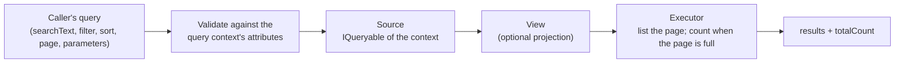

# Queries

What a service **knows**. A query never changes anything; steps do ([Processes](processes.md)). The
examples continue the orders service (`docs/guide/examples/Queries`); a test runs each of them.

## Sources, query contexts and views

| Piece | What it is |
|---|---|
| **Query context** (`IQueryContext`) | The record callers query: its attributes declare what is filterable (with which operators), searchable and sortable, and describe each field |
| **Source** (`IQuerySource<TContext>`, or `IQuerySourceAsync<TContext>`) | Returns an `IQueryable` of the query context: an EF Core query, a list in memory, anything LINQ can run |
| **View** (`IQueryViewSource<TSource, TContext, TView>`, optionally with parameters) | A projection of a local source for one purpose (a list, a card), with its own paging |
| **Delegated source** (`IDelegatedQuerySource<TContext, TResult>`, optionally with parameters) | Answers the query itself, for data Kaleido cannot run as LINQ (another service's API, a search engine) |

The source of the [getting-started](getting-started.md#2-a-query-source) example is a local source;
every attribute and rule is in [PATTERNS - Queryable](../PATTERNS.md#queryable-sources-views-and-query-contexts).



## The query a caller sends

`POST /{service}/queryable/{Source}/query`, or `/{service}/queryable/{Source}/{View}/query`:

```json
{
  "parameters": { "minimumQuantity": 5 },
  "query": {
    "searchText": "Book",
    "filter": { "condition": { "field": "Number", "operator": "Equals", "values": [2] } },
    "sort": [{ "field": "Number", "direction": "Descending" }],
    "page": { "size": 10, "offset": 0 }
  }
}
```

- Kaleido **validates** the query against the declared capabilities: a field that is not
  `[Filterable]` with that operator, or not `[Sortable]`, is a **400**, never silently ignored.
- It **applies** search, filters, sort and paging to the source's `IQueryable`, so on EF Core they
  reach the database.
- It **pages** with `[Pageable(DefaultSize, MaxSize)]`; without a sort, results are ordered by the
  `DefaultSortField`, so pages are stable.
- It **counts** the total only when the page cannot tell (a full page, or an empty page past the
  start); `totalCount` is always the number of matching results.

The wire contract: [`Kaleido.Http` README](../../src/Kaleido.Http/README.md).

## Views

<!-- snippet: queries-view -->
```csharp
// A view: one projection of a source, for one purpose (here, a list), with its own paging.
public sealed record OrderLine
{
    [Description("The order number and what was ordered.")]
    public string Label { get; init; } = string.Empty;
}

[QueryView(
    Version = "1.0.0",
    DisplayName = "Order lines",
    Description = "One line per order, for lists.",
    DefaultSortField = nameof(OrderQueryContext.Number))]
[Pageable(DefaultSize = 10, MaxSize = 50)]
public sealed class OrderLineView : IQueryViewSource<OrderSource, OrderQueryContext, OrderLine>
{
    public IQueryable<OrderLine> CreateView(IQueryable<OrderQueryContext> query, QueryExecutionContext executionContext) =>
        query.Select(x => new OrderLine { Label = "#" + x.Number + " " + x.Item });
}
```

A view has its own paging, and parameters when it needs them; the caller sends them as `parameters`:

<!-- snippet: queries-view-parameters -->
```csharp
// A view with parameters: the caller supplies them with the query.
public sealed record LargeOrdersParameters : IQueryParameters
{
    [Range(1, 10)]
    [Description("The smallest quantity to include.")]
    public int MinimumQuantity { get; init; } = 5;
}

[QueryView(
    Version = "1.0.0",
    DisplayName = "Large orders",
    Description = "Orders of at least the given quantity.",
    DefaultSortField = nameof(OrderQueryContext.Number))]
[Pageable(DefaultSize = 10, MaxSize = 50)]
public sealed class LargeOrdersView
    : IQueryViewSource<OrderSource, OrderQueryContext, OrderQueryContext, LargeOrdersParameters>
{
    public IQueryable<OrderQueryContext> CreateView(IQueryable<OrderQueryContext> query, QueryExecutionContext executionContext)
    {
        var minimum = executionContext.TryGetViewParameters<LargeOrdersParameters>()?.MinimumQuantity ?? 5;
        return query.Where(x => x.Quantity >= minimum);
    }
}
```

## Delegated sources

<!-- snippet: queries-delegated -->
```csharp
// A delegated source answers the query itself: for data Kaleido cannot run as LINQ (another
// service's API, a search engine). Kaleido still validates the caller's query against the context.
public sealed record ShippingRateQueryContext : IQueryContext
{
    [Description("The carrier.")]
    [Filterable(FilterOperator.Equals)]
    public string Carrier { get; init; } = string.Empty;
}

public sealed record ShippingRate
{
    [Description("The carrier.")]
    public string Carrier { get; init; } = string.Empty;

    [Description("The price in euros.")]
    public decimal Price { get; init; }
}

public sealed record ShippingRateParameters : IQueryParameters
{
    [Required]
    [Description("The destination country, as an ISO code (NL, DE...).")]
    public string Country { get; init; } = string.Empty;
}

[QuerySource(
    Version = "1.0.0",
    DisplayName = "Shipping rates",
    Description = "Today's rates from the carriers' price service.")]
public sealed class ShippingRateSource
    : IDelegatedQuerySource<ShippingRateQueryContext, ShippingRate, ShippingRateParameters>
{
    public Task<QueryResult<ShippingRate>> ExecuteAsync(
        IQueryRequest<ShippingRateParameters> request,
        CancellationToken cancellationToken)
    {
        // In a real service: call the price service with the request's filter and paging.
        ShippingRate[] rates = request.ViewParameters?.Country == "NL"
            ? [new() { Carrier = "post", Price = 4.95m }, new() { Carrier = "courier", Price = 9.50m }]
            : [new() { Carrier = "post", Price = 12.00m }];

        return Task.FromResult(new QueryResult<ShippingRate>(rates.Length, 0, rates.Length, rates));
    }
}
```

Kaleido validates the caller's query against `ShippingRateQueryContext` first, then hands the request
(query and parameters) to the source, and returns its `QueryResult` **untouched**, paging included:
the order and the total are the downstream's. Forwarding the query to another Kaleido service:
`query.ToApiBody()` (`Kaleido.Http.Abstractions`).

## Who may query, and which rows

A source or view is a capability like a step: `KaleidoAuthorizationAttribute` narrows it to roles or
a policy, and the registry shows each caller only what it may query
([Callers and correlation](callers-and-correlation.md)). **Which rows** a caller may see is the
source's job: filter by the caller, read from `IKaleidoCorrelationContextAccessor`.

<!-- snippet: queries-caller -->
```csharp
// Record-level access is the source's job: this one returns only the calling customer's invoices.
public sealed record InvoiceQueryContext : IQueryContext
{
    [Description("The invoice number.")]
    [Sortable]
    public int Number { get; init; }

    [Description("The customer the invoice is for.")]
    public string Customer { get; init; } = string.Empty;

    [Description("The amount in euros.")]
    public decimal Amount { get; init; }
}

[QuerySource(
    Version = "1.0.0",
    DisplayName = "My invoices",
    Description = "The calling customer's invoices.",
    DefaultSortField = nameof(InvoiceQueryContext.Number))]
[Pageable(DefaultSize = 20, MaxSize = 100)]
public sealed class MyInvoicesSource(IKaleidoCorrelationContextAccessor correlation) : IQuerySource<InvoiceQueryContext>
{
    private static readonly InvoiceQueryContext[] Invoices =
    [
        new() { Number = 1, Customer = "ann", Amount = 20m },
        new() { Number = 2, Customer = "ben", Amount = 35m },
        new() { Number = 3, Customer = "ann", Amount = 12m },
    ];

    public IQueryable<InvoiceQueryContext> CreateQuery(QueryExecutionContext executionContext)
    {
        // The caller comes from the authenticated principal, never from a header or the query.
        var caller = correlation.Current.CallerName;
        return Invoices.Where(x => x.Customer == caller).AsQueryable();
    }
}
```

## Counting and listing on your database

Listing the page and counting the total is `IQueryContextExecutor<TView>`. Kaleido's default works
for any LINQ source but counts an async query by **reading every matching row**. On EF Core, register
the EF Core executor, so a full page is counted with one `SELECT COUNT(*)`; it uses LINQ for any other
source of the host. The code: [PATTERNS - Queryable](../PATTERNS.md#queryable-sources-views-and-query-contexts).

## Queries as lookups

A step input the user cannot type (an id) names the query that supplies it with `[Lookup]`: UIs and
agents search that source, show the matches, and pass the chosen field
([PATTERNS - Lookup inputs](../PATTERNS.md#lookup-inputs-ids-the-user-cannot-type)).

## Events

Every query writes a `QueryExecuted` event (outside any transaction; a failure to write it never
fails the query). See [Events and the outbox](events-and-outbox.md).
