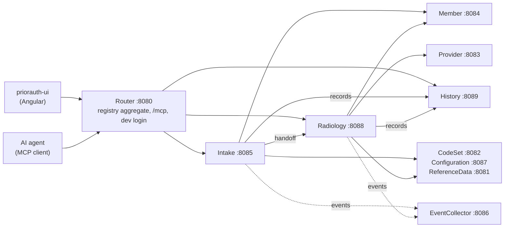

# Prior authorization sample

A prior-authorization intake built with Kaleido: a caller identifies a member, says what imaging
service is needed, and the request moves from a generic **Intake** process to the **Radiology**
process that owns it, through the questions Radiology needs, to submission. The same steps serve a
web UI, an AI agent over MCP, and service-to-service calls.

This README is a short walkthrough. The conventions and details live in
[`AGENTS.md`](AGENTS.md) (auth model, history, audit fields, configuration, ports) and
[`HANDOFF.md`](HANDOFF.md) (the cross-processor handoff, backend and UI).

## What runs



| Host | Role |
|---|---|
| Router | One entry point: the aggregated registry of every service, the MCP endpoint (`/mcp`), the dev login (`POST /auth/login`), and a reverse proxy to the services and the UI. |
| Intake | The front door process: start, find the member, capture the requested service, hand off to the product process. |
| Radiology | The product process: MRI/CT questions, providers, clinical questions, review, submit. |
| History | One record per request with its latest snapshot; the request list in the UI and the agent's first tool. |
| Member, Provider, CodeSet, Configuration, ReferenceData | Query sources (member search, provider search, procedure codes, questionnaires and routing rules, plans and states). |
| EventCollector | Receives the services' events (redacted PHI) so they can be inspected. |

Each service has its own SQLite database under `data/`; Intake and Radiology also keep Kaleido's
process state, outbox and idempotency records in a `*-process.db`.

## Run it

1. **Seed** the shared reference databases (once, and after reference data changes):

   ```powershell
   dotnet run --project samples/PriorAuth/Seeder/Kaleido.Samples.PriorAuth.Seeder.csproj -- --domains=ReferenceData,CodeSet,Configuration,ProviderSearch,MemberService
   ```

2. **Start** everything, either way:
   - **Containers** (Production settings): `podman compose up --build` in `samples/PriorAuth/Compose/`.
     The router serves the UI at `http://localhost:8080`; the Aspire dashboard is at `http://localhost:18888`.
   - **Locally** (Development settings): `dotnet run` the router, the services and the EventCollector
     (projects under `Router/`, `Services/*/`, `EventCollector/`), and `npm start` in `priorauth-ui/`.
     Open the UI at `http://localhost:4200`, or through the router at `http://localhost:8080`.
     For traces, `npx @microsoft/aspire-cli dashboard run`.

3. **Sign in** with a persona from the UI's persona picker (the router's dev login issues a signed
   token; nothing here is a real identity provider).

The databases are created at startup with `EnsureCreated`, which never changes an existing file:
after an entity change, delete the affected `.db` (see [`AGENTS.md`](AGENTS.md#local-run-workflow)).

## Personas: who can do what

| Persona | Roles | Can |
|---|---|---|
| `alice` | none | use Intake and the searches; is refused at the hand-off to Radiology |
| `bob` | `radiology` | run a request through Intake and Radiology to submission |
| `carol` | `admin`, `radiology` | the same as bob in this sample |

Every host enforces authorization (`ZeroTrust`): each service declares who may use it, and a
capability without a rule is not published at all. The registry is filtered per caller, so alice's
UI and agent never see Radiology's steps. When Intake hands a request to Radiology it calls **on
behalf of** the user (the same name and roles, plus the calling service as the actor), so Radiology
still knows it is bob; some capabilities accept only service-to-service calls. The rules are in
[`AGENTS.md`](AGENTS.md#auth-model).

## A request, end to end

Signed in as bob, in the UI or through an agent:

| # | Process | Step | What happens |
|---|---|---|---|
| 1 | Intake | Start | A process is created; its id travels on every later call, searches included. |
| 2 | Intake | Validate Member, Capture Member | The member comes from a lookup over the Member search (name, member ID, date of birth); the caller picks the match. |
| 3 | Intake | Capture Requested Service | The procedure code decides the product (Configuration's routing rules): an imaging code hands the request to **Radiology** with the same process id. The response names the target processor; the consumer reads Radiology's state next ([`HANDOFF.md`](HANDOFF.md)). |
| 4 | Radiology | Capture MRI Information, or Confirm CT Instead Of MRI | An **information request**: Radiology asks the questions configured for the service (some only when an earlier answer makes them apply). The UI shows a form; an agent asks the user round by round. |
| 5 | Radiology | Capture Requesting Provider, Capture Servicing Provider | Providers come from searches that only Radiology may call; Radiology publishes them to the caller as views over those internal searches. |
| 6 | Radiology | Capture Clinical Information | Clinical questions, when the service requires them. |
| 7 | Radiology | Review, Submit | A review of everything captured, then an attestation as the last information request. |

After every step that changes what a reviewer would see, the process records its snapshot in
**History** (the step fails if History does not record it). Each row in the Intake, Radiology and History databases also records who created and last changed it,
through which service, and when ([audit fields](AGENTS.md#audit-fields)).
The **History** page lists requests; a request can be resumed from there.

To follow one request across services, filter the Aspire dashboard by its process id or request id:
every hop carries both (correlation headers), and the events the services publish reach the
EventCollector with PHI removed.

## Connect an AI agent

The router's MCP endpoint is `http://localhost:8080/mcp`. It needs a persona's token:
`./samples/PriorAuth/scripts/mcp-login.ps1 bob` signs in and stores the token where the
repository's MCP configuration reads it. The agent starts with a short list of tools (the request
list and the entry steps); the next steps, their inputs and the searches they need arrive with each
response as the process moves on.

## More

- [`AGENTS.md`](AGENTS.md): conventions, auth model, history recording, audit fields, configuration per environment, ports
- [`HANDOFF.md`](HANDOFF.md): the Intake to Radiology handoff, its contract and the UI's handling
- [Consumer guide](../../docs/guide/README.md): Kaleido's concepts with a smaller, tested example
- [MCP adapter](../../src/Kaleido.Http.Mcp/README.md): tool listing, information requests over MCP
